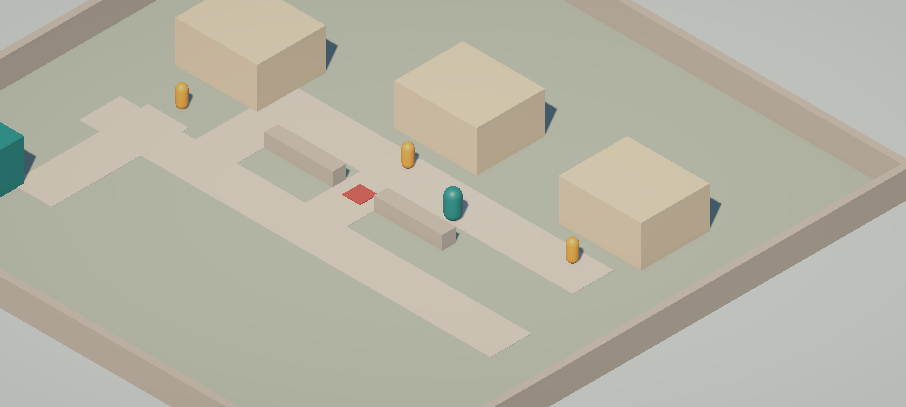

# Jejak Asa

**Bantuan sampai, harapan tumbuh.**

Game tugas akhir Grafika Komputer: RPG 3D low-poly tentang lulusan baru yang kembali ke kampung fiktif di Jakarta Utara untuk membantu distribusi bantuan sosial. Pemain mengatur rute, mengantar bantuan, dan menghadapi intimidasi dengan menghindar, bertengkar, atau meminta dukungan warga.

Tema utama adalah SDG 1 — Tanpa Kemiskinan, didukung SDG 11 — Kota dan Permukiman Berkelanjutan serta SDG 16 — Perdamaian, Keadilan, dan Kelembagaan yang Tangguh. Game tidak mengklaim bahwa bantuan sesaat menyelesaikan kemiskinan atau bahwa warga adalah penerima pasif.

## Sumber progres aktif

**README ini menjadi tempat pembaruan progres proyek mulai sekarang.** Dokumen pada `docs/` tetap menjadi acuan desain dan rencana kerja; catatan progres di dalam dokumen lama adalah snapshot, bukan tracker yang terus diperbarui. Pembaruan progres berikutnya tidak perlu mengubah DOCX/PDF tersebut.

Checkbox U adalah kriteria penerimaan game, bukan nomor hari atau checklist yang harus dikerjakan setiap role. D adalah target hari pada rencana. Milestone `AB-M` melacak pekerjaan kolaboratif A/B; `C-M` melacak hasil kerja C. Satu U atau milestone yang lulus tidak otomatis menyelesaikan seluruh hari, role, atau produk.

## Teknologi dan cakupan

| Bagian | Pilihan proyek |
| --- | --- |
| Editor | Unity 6.3 LTS **6000.3.27f1**, sama untuk semua anggota |
| Rendering | Universal Render Pipeline / URP |
| Platform | Windows, single-player, keyboard dan mouse |
| Kamera | Isometrik dengan orientasi tetap |
| Kontrol | Input System resmi; CharacterController untuk gerak |
| Antarmuka | Unity UI / uGUI dan TextMeshPro saat tahap UI dikerjakan |
| Cakupan target | Satu peta, satu misi, tiga penerima, satu pengintimidasi, dan satu arena turn-based |
| Waktu | Target 21 hari; Hari 22–28 cadangan stabilisasi, bukan penambahan fitur |

Urutan development adalah **gameplay-first**: Kampung → gerak → interaksi → pengantaran → timer/hasil/ulang → intimidasi dan battle → main menu. Main menu direncanakan pada D11, bukan prasyarat build awal.

Tidak termasuk baseline: multiplayer, akun/backend, database server, inventori kompleks, crafting, banyak map/chapter, save/load lintas sesi, dan boss cerita final.

## Status saat ini

- **U01 selesai untuk A/B berdasarkan konfirmasi anggota tim:** proyek hasil clone dan build awal dapat dijalankan. Verifikasi setup anggota C belum dilaporkan.
- **U02 lulus di Unity Editor:** lima tes Play Mode lulus, meliputi gerak, collision, kamera, dan penelusuran jalur pada Kampung aktual. Tes jalur diulang sesudah tinggi pembatas diubah dan tetap lulus.
- Source sudah mendukung WASD/panah dengan kecepatan awal 3,5 meter/detik, gerak relatif kamera, normalisasi diagonal, gravitasi, dan kamera follow dengan sudut tetap.
- Peta masih graybox. Rumah berbentuk kubus; pemain/warga berbentuk capsule. Penanda intimidasi belum aktif dan belum ada interaksi E, dialog, misi, timer, atau battle.
- **Build Windows belum dibuat ulang setelah U02.** Build D1 tidak otomatis memperoleh perubahan source terbaru. Belum ada verifikasi U02 pada executable baru atau komputer lain.



Cuplikan runtime, bukan render konsep atau visual final.

## Pembagian tiga role

Dua anggota berkolaborasi pada A/B, satu anggota menangani C. Tidak ada penetapan nama di README. Setiap tugas/file tetap memiliki satu pemilik untuk mencegah konflik edit.

| Role | Tanggung jawab | Batas progres saat ini |
| --- | --- | --- |
| A — Gameplay dan integrasi | Gerak, interaksi, misi/timer/trust, encounter, integrasi scene dan build | Implementasi U02 selesai; sistem misi dan integrasi battle belum dikerjakan. |
| B — Battle dan verifikasi | Giliran, HP/aksi, pola musuh, hasil battle, transisi serta regresi | Verifikasi U02 selesai. Ini **bukan** penyelesaian B01–B10; arena dan sistem battle masih belum tersedia. |
| C — Visual, level, UI, audio | Aset low-poly, layout, prefab visual/UI, animasi, suara, serta keterbacaan | Graybox dasar tersedia untuk ditindaklanjuti; penyelesaian tugas C belum dilaporkan dan tidak otomatis dicentang. |

## Tracking penerimaan

`[x]` berarti kriterianya telah dibuktikan atau dikonfirmasi dengan sumber bukti yang disebutkan. `[ ]` berarti belum selesai atau belum diverifikasi; keberadaan penanda/aset saja bukan kelulusan fitur.

- [x] **U01 — Setup awal A/B:** clone bersih dan build Windows awal berjalan; berdasarkan konfirmasi tim. Tidak menyatakan build U02 sudah tersedia.
- [x] **U02 — Gerak dan collision:** kecepatan lurus/diagonal setara, tidak menembus rumah, dan jalur wajib dapat dilalui. A: implementasi; B: regresi/verifikasi; lima tes Play Mode lulus.
- [ ] **U03 — Satu interaksi:** saat beberapa target dekat, satu tekan E hanya memicu satu interaksi.
- [ ] **U04 — Penyerahan valid:** paket, status penerima, dan trust berubah sekali; klik cepat tidak menggandakan progres.
- [ ] **U05 — Penerima dan urutan:** penerima selesai tidak menerima paket lagi; urutan pengantaran bebas.
- [ ] **U06 — Timer per state:** aktif saat eksplorasi, berhenti pada state yang ditentukan.
- [ ] **U07 — Prioritas akhir misi:** penyerahan terlambat ditolak; keberhasilan sah tidak ditimpa hasil gagal ganda.
- [ ] **U08 — Hasil misi:** berhasil/parsial/gagal, penerima selesai, dan penyebab akhir sesuai sesi.
- [ ] **U09 — Menghindar:** pilihan tidak langsung memicu encounter lagi dan jalur alternatif mencapai semua tujuan. Jalur graybox sudah diuji, tetapi mekanik menghindar belum ada.
- [ ] **U10 — Bantuan warga:** terkunci dengan alasan pada trust 0; tersedia setelah satu pengantaran dan benar-benar membuka jalan tanpa battle.
- [ ] **U11 — Menang battle:** urutan Serang ×3, Bertahan, Serang ×2 menang dengan HP pemain 4 pada angka baseline.
- [ ] **U12 — Kalah battle:** empat Serang beruntun kalah pada serangan kuat pertama; penyebab akhir sesuai.
- [ ] **U13 — Guard sekali pakai:** Bertahan pada giliran Persiapan tidak terbawa ke serangan berikutnya.
- [ ] **U14 — Aksi battle tunggal:** klik cepat tidak memberi aksi ganda; lawan HP 0 tidak membalas; hasil dikirim sekali.
- [ ] **U15 — Kembali dari battle:** timer, paket, trust, dan penerima tetap; musuh selesai tidak muncul lagi pada sesi itu.
- [ ] **U16 — Pause battle:** aksi tertunda berhenti dan resume kembali pada giliran yang benar tanpa damage ganda.
- [ ] **U17 — Retry bersih:** tiga pengulangan mereset seluruh sesi tanpa data/event lama, termasuk sesudah kalah battle setelah terintegrasi.
- [ ] **U18 — Menu:** Mulai/Keluar, konfirmasi kembali ke menu, pembatalan, serta sesi baru berfungsi; mulai ditargetkan D11.
- [ ] **U19 — Kamera dan audio final:** hanya kamera/listener yang benar aktif; musik tidak bertumpuk setelah transisi dan retry.
- [ ] **U20 — UI:** terbaca pada 1920×1080 dan 1280×720, fokus keyboard benar, prompt serta alasan tombol terkunci tidak terpotong.
- [ ] **U21 — Build final komputer kedua:** menu, misi, retry, dan keluar berjalan tanpa Editor atau internet.

## Milestone per jalur kerja

A/B dan C memiliki output serta urutan pekerjaan berbeda. Target hari tetap mengacu pada rencana 21 hari yang sama, tetapi progres kedua jalur dicatat sendiri-sendiri. Nomor milestone mengelompokkan hasil, bukan memaksa semua pekerjaan berjalan berurutan; persiapan battle dapat berjalan paralel dengan pengantaran.

`Selesai` memerlukan bukti pada kolom kriteria. `Belum` pada A/B berarti hasilnya belum tersedia atau belum dinyatakan selesai. `Belum dilaporkan` pada C berarti belum ada bukti dari pemiliknya, **bukan klaim bahwa C belum bekerja**. Tidak ada nama anggota yang ditetapkan di tabel ini.

### Jalur A/B — Sistem gameplay dan verifikasi

| ID | Target | Output dan pembagian kerja | Kriteria selesai / bukti | Status |
| --- | --- | --- | --- | --- |
| AB-M01 | D1 | Setup proyek, repository, clone, dan build awal. Satu anggota menyiapkan; anggota lain memeriksa. | Proyek 6000.3.27f1 hasil clone dan build awal berjalan. Bukti U01 berdasarkan konfirmasi anggota A/B; tidak menunggu laporan C untuk menutup milestone A/B ini. | Selesai |
| AB-M02 | D2–D3 | A: graybox navigasi, gerak, collision, kamera. B: regresi dan uji jalur. | U02 lulus: lima tes Play Mode serta pengujian ulang jalur setelah perubahan pembatas. Tidak mencakup input lock state atau loop misi. | Selesai |
| AB-M03 | D2–D3 | B: arena Battle mandiri. A/B: kontrak data, hasil menang/kalah, dan tanggung jawab state. | Arena dapat dibuka sendiri; titik karakter tersedia; kontrak disepakati tanpa ketergantungan pada MainMenu. Milestone ini tidak otomatis selesai oleh U02. | Belum |
| AB-M04 | D4–D7 | A: interaksi, input lock per state, tiga penerima, paket/trust, timer, hasil, pause, retry. B membantu verifikasi batas dan regresi. | U03–U08 lulus; loop mulai → antar → hasil → ulang berjalan tiga kali. Bagian U17 terkait battle baru ditutup setelah integrasi. | Belum |
| AB-M05 | D3–D7 | B: HP, Serang/Bertahan, pola lawan, telegraph, giliran, menang/kalah. A membantu menguji kontrak hasil. | Battle mandiri dapat dimainkan; U11–U14 lulus dan tidak mengirim hasil ganda. | Belum |
| AB-M06 | D8–D10 | A: encounter, menghindar, trust/bantuan warga. A/B: transisi battle additive, kembali ke sesi, pause battle, dan reset. | U09, U10, U15, U16 serta U17 lengkap lulus. Jalur, waktu, paket, dan penerima tetap benar setelah transisi. | Belum |
| AB-M07 | D11 | A: MainMenu, navigasi, konfirmasi keluar sesi. B memeriksa masuk/keluar misi dan regresi battle. | U18 lulus. Menu memakai loop yang sudah bekerja, bukan memiliki salinan logika misi. Memakai prefab menu C setelah handoff. | Belum |
| AB-M08 | D12–D14 | Integrasi aset/UI/audio dari C, pengujian alpha, dan pembekuan fitur. | Semua fitur wajib tersambung; U19/U20 diuji bersama C pada build terintegrasi. Belum cukup jika hanya scene percobaan yang bekerja. | Belum |
| AB-M09 | D15–D18 | Playtest, perbaikan, kalibrasi angka, regresi, dan release candidate. | Catatan playtest nyata; tidak ada blocker atau tombol kosong; kandidat rilis cocok dengan source dan aturan terbaru. | Belum |
| AB-M10 | D19–D21 | Stabilisasi, build bersih, pengujian komputer kedua, dan pengumpulan source/build. | U21 lulus; build final, source, bukti uji, serta known issues non-blocking siap. | Belum |

**Batas status saat ini:** AB-M01 dan AB-M02 selesai. Hari D2/D3 secara keseluruhan belum selesai karena AB-M03, battle dasar, dan input lock state masih tersisa. Kontribusi verifikasi B pada AB-M02 tidak menutup milestone battle B.

### Jalur C — Visual, level, UI, dan audio

| ID | Target | Output yang diserahkan C | Kriteria selesai / bukti | Status |
| --- | --- | --- | --- | --- |
| C-M01 | D1–D2 | Setup proyek C, skala/palet, daftar kebutuhan aset, serta sumber/lisensi. | C dapat membuka proyek yang sama; daftar kebutuhan dan sumber aset dapat ditinjau. U01 A/B tidak otomatis membuktikan setup C. | Belum dilaporkan |
| C-M02 | D2 | Rancangan layout dan penempatan tujuan bersama A/B. | Pos awal, tiga tujuan, gang utama, jalur memutar, serta titik encounter disepakati. Graybox buatan A/B sudah tersedia; kontribusi/handoff C tetap perlu dikonfirmasi. | Belum dilaporkan |
| C-M03 | D3–D5 | Prefab visual pemain, warga, dan musuh low-poly. | Skala, orientasi, material URP, dan identitas visual konsisten; aset dapat dipakai A/B dan asal/lisensinya jelas. | Belum dilaporkan |
| C-M04 | D4–D6 | Prefab briefing, HUD, dialog, encounter, battle UI, pause, dan hasil/retry. Main menu belum diprioritaskan. | Teks, anchor, fokus, tombol, serta state terkunci/aktif lengkap; referensi untuk pengikatan controller disertakan. Penyerahan prefab bukan bukti logika misi/battle sudah selesai. | Belum dilaporkan |
| C-M05 | D5–D8 | Lingkungan modular, bangunan, jalan, paket, penanda penerima, dan dekor minimum. | Prefab diserahkan untuk mengganti graybox; A/B memasangnya dan memeriksa ulang jalur/collider. C tidak menimpa logika atau scene integrasi tanpa handoff. | Belum dilaporkan |
| C-M06 | D7–D10 | Idle/jalan dan respons visual serang, bertahan, kena, serta bantuan warga. | Aksi terbaca dan dapat dipicu controller A/B; tidak membutuhkan animasi kompleks atau AI baru. | Belum dilaporkan |
| C-M07 | D11 | Prefab MainMenu, musik eksplorasi/battle, SFX tindakan utama, dan pencahayaan. | Prefab siap diikat A; audio dan sumber/lisensi tersedia; suara tidak bertumpuk ketika diuji bersama sistem transisi. | Belum dilaporkan |
| C-M08 | D12–D14 | Pemeriksaan visual/UI/audio pada build terintegrasi. | U19/U20 diperiksa bersama A/B: tampilan 1920×1080 dan 1280×720, fokus UI, prompt, penanda, serta audio transisi benar. | Belum dilaporkan |
| C-M09 | D15–D18 | Perbaikan keterbacaan dan performa visual berdasarkan playtest. | Masalah yang ditemukan pengguna ditutup, tampilan tidak menghambat navigasi, dan hasil pemeriksaan dicatat pada kandidat rilis. | Belum dilaporkan |
| C-M10 | D19–D21 | Kredit aset, screenshot build aktual, dan materi demo final. | Kredit sesuai aset yang benar-benar dipakai; gambar/demo cocok dengan build rilis A/B, bukan hanya render konsep. | Belum dilaporkan |

### Titik handoff dan penerimaan bersama

- **D2:** A/B dan C menyepakati layout, skala, penempatan penanda, serta kebutuhan referensi prefab. A/B membekukan kontrak logika misi/battle.
- **D6:** C menyerahkan prefab UI awal. A/B menghubungkannya ke logika nyata. Jika visual belum final, A/B tetap membuktikan loop dengan UI sederhana yang berfungsi; tidak menunggu semua aset selesai.
- **D10–D12:** visual, animasi, UI, dan audio digabungkan dengan sistem misi/battle. Perubahan layout atau collider memerlukan uji jalur kembali. Milestone aset dan milestone logika tidak saling menggantikan.
- **D14:** alpha dan pembekuan fitur diperiksa bersama. U19/U20 hanya dicentang sesudah hasil integrasi diuji, bukan ketika prefab diserahkan.
- **D21:** kedua jalur bertemu pada build/source final yang sama. Kebutuhan kontribusi C tidak dihapus hanya karena milestone A/B sudah selesai, dan sebaliknya.
- **D22–D28:** cadangan bersama hanya untuk pengujian, perbaikan bug, dan latihan presentasi; bukan tempat menunda fitur wajib atau menambah map/boss.

### Pekerjaan berikutnya

1. A/B mengerjakan **U03**: interaksi dekat dengan satu target aktif, prompt E, dan pencegahan interaksi ganda. Belum perlu menghitung penyerahan paket pada tahap ini.
2. B tetap menyiapkan **B01/arena Battle mandiri dan kontrak hasil menang/kalah**, terpisah dari scene Kampung.
3. C melanjutkan layout/aset serta prefab UI yang mendukung interaksi; tidak menunggu main menu.
4. Sebelum menandai satu hari atau gerbang selesai, periksa semua hasil wajibnya, bukan hanya U02.

## Membuka dan menjalankan proyek

1. Clone repository ini. Di Unity Hub pilih **Add project from disk**, lalu pilih `Unity/JejakAsa`, bukan root repository atau folder `Assets`.
2. Buka menggunakan Editor **6000.3.27f1**. Tunggu import dan pemulihan package dari `Packages/` selesai; pembukaan pertama dapat memerlukan internet.
3. Buka [`Kampung.unity`](Unity/JejakAsa/Assets/_Project/Scenes/Kampung.unity).
4. Tekan **Play** dan klik tab **Game** agar keyboard diterima game.
5. Gunakan WASD atau panah. Kamera mengikuti dengan sudut tetap; belum ada sprint/lompat.
6. Keluar dari Play Mode sebelum mengedit scene. Posisi saat bermain tidak otomatis menjadi posisi spawn tersimpan.

E dan Esc belum memiliki fungsi gameplay pada source saat ini. Jangan menganggapnya rusak sebelum tahap interaksi/pause dikerjakan.

### Pengujian manual U02

- Coba arah lurus, diagonal, tombol searah bersamaan, dan arah berlawanan.
- Jalan menuju sisi rumah; pemain harus tertahan. Input diagonal ke dinding harus tetap memungkinkan bergerak menyusuri sisi dinding.
- Lewati celah tengah dan gang memutar di kiri pembatas, lalu dekati ketiga penanda warga.
- Pastikan pemain tidak jatuh menembus lantai dan kamera tidak berputar mengikuti arah hadap.

Visual masih sederhana. Kamera belum memiliki penanganan occlusion bangunan atau pembatas posisi di tepi peta.

### Pengujian otomatis U02

Di Unity buka **Window → General → Test Runner**, pilih **PlayMode**, pilih assembly `JejakAsa.PlayModeTests`, lalu **Run Selected**. Suite U02 saat ini berisi lima tes, bukan seluruh U01–U21.

Tes mengirim input keyboard sintetis ke controller sebenarnya. Tes level memuat Kampung aktual, menelusuri rute, lalu membongkar scene percobaan. Input fixture dipulihkan sesudah pengujian. Jangan menghentikan runner atau mengubah scene di tengah tes.

Jika layout berubah, tinjau waypoint pada tes rute serta buktikan semua penerima tetap dapat dijangkau. Kelulusan lama bukan bukti bahwa perubahan baru sudah aman.

## Membuat build Windows terbaru

1. Keluar dari Play Mode dan simpan scene.
2. Buka **File → Build Profiles** dan aktifkan Windows.
3. Pastikan Kampung menjadi scene pertama yang aktif untuk tahap sebelum D11; jangan memakai scene percobaan sebagai entry point. Setelah main menu terimplementasi, entry point berubah sesuai U18.
4. Build ke `Unity/JejakAsa/Builds/Windows/`, bukan ke dalam `Assets`.
5. Jalankan executable di luar Editor dan bagikan seluruh folder hasil build jika diperlukan, bukan `.exe` saja.

Folder build dan cache Unity tidak di-commit. Build yang akan dibagikan harus dibuat dari source yang sama dengan commit rilisnya.

## Struktur penting

```text
README.md                         Deskripsi dan progres aktif
Unity/JejakAsa/
  Assets/_Project/
    Scenes/Kampung.unity           Scene gameplay awal
    Scripts/                      Controller gerak dan kamera
    Materials/                    Material graybox
    Tests/PlayMode/               Regresi U02
  Packages/                       Manifest dan lock file package
  ProjectSettings/                Konfigurasi dan versi Editor
  Builds/                         Hasil build lokal; diabaikan Git
docs/                             Acuan desain, rencana, presentasi, bukti visual
```

- [PlayerController](Unity/JejakAsa/Assets/_Project/Scripts/PlayerController.cs)
- [FixedIsometricCamera](Unity/JejakAsa/Assets/_Project/Scripts/FixedIsometricCamera.cs)
- [Tes gerak/collision](Unity/JejakAsa/Assets/_Project/Tests/PlayMode/U02MovementTests.cs)
- [Tes jalur Kampung](Unity/JejakAsa/Assets/_Project/Tests/PlayMode/U02KampungRouteTests.cs)
- [Desain game](docs/desain-game.md)
- [Rencana kerja acuan](docs/rencana-development-jejak-asa.md)
- [Presentasi desain](<docs/Kelompok Jejak Asa.pptx>)

## Aturan kolaborasi dan pembaruan tracker

- Pull sebelum mengedit; satu pemilik per scene/file. A/B membagi tugas dengan jelas meskipun saling membantu. C menyerahkan prefab visual/UI kepada pemilik scene integrasi.
- Commit `Assets` beserta `.meta`, `Packages`, dan `ProjectSettings`. Jangan commit `Library`, `Temp`, cache, kredensial, atau hasil build. Jangan mengabaikan seluruh file `.meta`.
- Update checkbox di README hanya setelah implementasi dan skenario terkait terbukti. Sebutkan apakah bukti berasal dari laporan anggota, tes Editor, atau build; jangan menyamakan ketiganya.
- Ketika perubahan mematahkan kriteria yang sebelumnya lulus, buka kembali status terkait sampai diperbaiki dan diuji. Gambar konsep, prefab kosong, atau tombol tanpa efek bukan fitur selesai.
- Catat batas yang belum diuji, terutama build terbaru, komputer kedua, aset/lisensi, dan kontribusi C yang belum dikonfirmasi. Jangan menetapkan nama atau persentase progres tanpa bukti.
- MCP for Unity dipakai untuk otomasi Editor lokal, bukan backend game. Jika digunakan, server tetap di localhost dan scene disimpan sebelum perubahan; jangan membuka endpoint ke internet.
