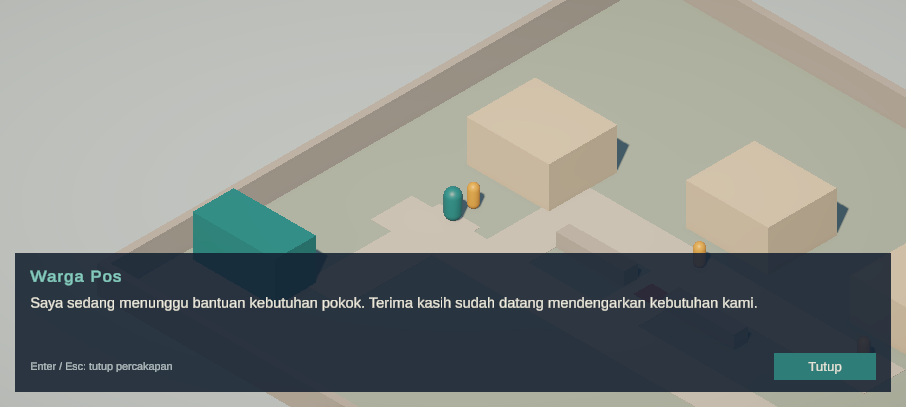

# Jejak Asa

**Bantuan sampai, harapan tumbuh.**

Game tugas akhir Grafika Komputer: RPG 3D low-poly tentang lulusan baru yang kembali ke kampung fiktif di Jakarta Utara untuk membantu distribusi bantuan sosial. Pemain mengatur rute, mengantar bantuan, dan menghadapi intimidasi dengan menghindar, bertengkar, atau meminta dukungan warga.

Tema utama adalah SDG 1 — Tanpa Kemiskinan, didukung SDG 11 — Kota dan Permukiman Berkelanjutan serta SDG 16 — Perdamaian, Keadilan, dan Kelembagaan yang Tangguh. Game tidak mengklaim bahwa bantuan sesaat menyelesaikan kemiskinan atau bahwa warga adalah penerima pasif.

## Sumber progres aktif

**README ini menjadi tempat pembaruan progres proyek mulai sekarang.** Dokumen pada `docs/` tetap menjadi acuan desain dan rencana kerja; catatan progres di dalam dokumen lama adalah snapshot, bukan tracker yang terus diperbarui. Pembaruan progres berikutnya tidak perlu mengubah DOCX/PDF tersebut.

Checkbox U adalah kriteria penerimaan game, bukan nomor hari atau checklist yang harus dikerjakan setiap role. D adalah target hari pada rencana. Milestone `AB-M` melacak pekerjaan kolaboratif A/B; `C-M` melacak hasil kerja C. Satu U atau milestone yang lulus tidak otomatis menyelesaikan seluruh hari, role, atau produk.

## Teknologi dan cakupan

| Bagian | Pilihan proyek |
| --- | --- |
| Editor | Unity 6.3 LTS **6000.3.27f1**, sama untuk semua anggota |
| Rendering | Universal Render Pipeline / URP |
| Platform | Windows, single-player, keyboard dan mouse |
| Kamera | Isometrik dengan orientasi tetap |
| Kontrol | Input System resmi; CharacterController untuk gerak |
| Antarmuka | Unity UI / uGUI dan TextMeshPro; prompt/dialog U03 sudah tersedia |
| Cakupan graybox saat ini | Satu peta, satu misi, tiga penerima, satu pengintimidasi, dan satu arena turn-based |
| Arah revisi yang direncanakan | Prolog; satu map posko dengan lingkungan; satu map interior rumah; lima map level terpisah; boss level 3 dan 5; save/load. Belum diimplementasikan |
| Waktu | Rencana awal 21 hari dan cadangan hingga 28 hari; estimasi untuk cakupan revisi perlu disusun ulang |

Urutan development **gameplay-first**: loop Kampung dan battle graybox telah tersambung ke main menu. Revisi progres lima level memerlukan perubahan core sebelum integrasi aset final.

Tidak termasuk rancangan saat ini: multiplayer, akun/backend, database server, crafting, serta chapter tambahan di luar lima level yang direncanakan.

## Status saat ini

- **U01 selesai untuk A/B berdasarkan konfirmasi anggota tim:** proyek hasil clone dan build awal dapat dijalankan. Verifikasi setup anggota C belum dilaporkan.
- **U02 lulus di Unity Editor:** lima tes Play Mode lulus, meliputi gerak, collision, kamera, dan penelusuran jalur pada Kampung aktual. Tes jalur diulang sesudah tinggi pembatas diubah dan tetap lulus.
- **U03 lulus di Unity Editor:** enam tes interaksi lulus, termasuk beberapa target berdekatan, batas jarak, tahan E, kunci gerak, serta dialog Kampung yang ditutup melalui klik mouse. Bersama lima regresi U02, total sebelas tes Play Mode lulus.
- Source sudah mendukung WASD/panah dengan kecepatan awal 3,5 meter/detik, gerak relatif kamera, normalisasi diagonal, gravitasi, dan kamera follow dengan sudut tetap.
- Peta, karakter, menu, dan UI masih graybox; model MC Meshy belum dipasang permanen.
- **U16–U18 versi graybox tersedia:** pause, tiga kali retry, main menu, dan konfirmasi kembali. Seluruh **36 tes Play Mode** lulus di Unity Editor setelah integrasi; tes mencakup pause saat serangan tertunda dan tiga retry sesudah kalah battle.
- U19–U21 tetap menunggu verifikasi build, pendengaran audio dan integrasi visual final, termasuk pengujian komputer kedua. Musik CC0 yang terpasang hanya untuk graybox.
- Build graybox Windows berhasil dibuat di `Unity/JejakAsa/Builds/Windows-Graybox-U21/JejakAsa.exe` dan menu pembukanya terlihat saat executable dijalankan di komputer ini. Pengujian alur executable dan komputer kedua belum dilakukan.



Cuplikan runtime aktual, bukan render konsep atau visual final. UI sederhana ini dapat diganti oleh prefab visual C tanpa memindahkan logika interaksi.

## Pembagian tiga role

Dua anggota berkolaborasi pada A/B, satu anggota menangani C. Tidak ada penetapan nama di README. Setiap tugas/file tetap memiliki satu pemilik untuk mencegah konflik edit.

| Role | Tanggung jawab | Batas progres saat ini |
| --- | --- | --- |
| A — Gameplay dan integrasi | Gerak, interaksi, misi/timer/trust, encounter, integrasi scene dan build | Loop misi dan menu graybox tersambung; uji pengguna dan build pada komputer lain masih diperlukan. |
| B — Battle dan verifikasi | Giliran, HP/aksi, pola musuh, hasil battle, transisi serta regresi | Battle, pause, kembali ke menu, dan tiga retry setelah kalah tercakup dalam 36 tes Play Mode yang lulus di Unity Editor. |
| C — Visual, level, UI, audio | Aset low-poly, layout, prefab visual/UI, animasi, suara, serta keterbacaan | Preview MC bertekstur sudah diuji; rig, animasi, model warga/musuh, dan integrasi final masih diperlukan. |

## Tracking penerimaan

`[x]` berarti kriterianya telah dibuktikan atau dikonfirmasi dengan sumber bukti yang disebutkan. `[ ]` berarti belum selesai atau belum diverifikasi; keberadaan penanda/aset saja bukan kelulusan fitur.

- [x] **U01 — Setup awal A/B:** clone bersih dan build Windows awal berjalan; berdasarkan konfirmasi tim. Tidak menyatakan build U02 sudah tersedia.
- [x] **U02 — Gerak dan collision:** kecepatan lurus/diagonal setara, tidak menembus rumah, dan jalur wajib dapat dilalui. A: implementasi; B: regresi/verifikasi; lima tes Play Mode lulus.
- [x] **U03 — Satu interaksi:** target aktif terdekat dalam radius horizontal 1,8 meter mendapat prompt E; satu penekanan membuka satu dialog, bukan semua warga atau berulang saat E ditahan. Enam tes interaksi lulus, termasuk UI aktual dan klik Tutup.
- [x] **U04 — Penyerahan valid:** paket, status penerima, dan trust berubah sekali saat penyerahan via tombol E; transaksi tunggal dan dialog warga bervariasi; regresi diuji lewat U04DeliveryTests.
- [x] **U05 — Penerima dan urutan:** tiga penerima dapat diantar dengan urutan bebas; penerima selesai tidak menerima paket lagi; selesai otomatis saat 3/3; diuji lewat U05OrderTests.
- [x] **U06 — Timer per state:** timer 180s aktif saat eksplorasi, membeku saat dialog terbuka dan saat misi selesai; penyerahan terlambat ditolak; diuji lewat U06TimerTests.
- [X] **U07 — Prioritas akhir misi:** penyerahan terlambat ditolak; keberhasilan sah tidak ditimpa hasil gagal ganda.
- [X] **U08 — Hasil misi:** berhasil/parsial/gagal, penerima selesai, dan penyebab akhir sesuai sesi.
- [X] **U09 — Menghindar:** status selesai dipertahankan berdasarkan laporan/merge tim; tidak dijalankan ulang pada pengujian preview MC.
- [X] **U10 — Bantuan warga:** terkunci dengan alasan pada trust 0; tersedia setelah satu pengantaran dan benar-benar membuka jalan tanpa battle.
- [x] **U11 — Menang battle:** urutan Serang ×3, Bertahan, Serang ×2 menang dengan HP pemain 4 pada angka baseline; diuji lewat `U11BattleTests` di Unity Editor.
- [x] **U12 — Kalah battle:** empat Serang beruntun kalah pada serangan kuat pertama; penyebab akhir sesuai; diuji lewat `U11BattleTests` dan `U15BattleIntegrationTests` di Unity Editor.
- [x] **U13 — Guard sekali pakai:** Bertahan pada giliran Persiapan tidak terbawa ke serangan berikutnya; diuji lewat `U11BattleTests` di Unity Editor.
- [x] **U14 — Aksi battle tunggal:** aksi tetap terkunci sampai lawan dan pemain selesai kembali ke posisi setelah animasi; musuh HP 0 tidak membalas dan hasil dikirim sekali. Regresi arena nyata untuk serangan biasa dan kuat serta tes battle terarah lulus.
- [x] **U15 — Kembali dari battle:** timer, paket, trust, dan penerima tetap; musuh selesai tidak muncul lagi pada sesi itu; diuji lewat `U15BattleIntegrationTests` dan Play Mode di Unity Editor.
- [x] **U16 — Pause battle:** aksi tertunda berhenti dan resume menyelesaikan satu giliran tanpa damage ganda; diuji dengan `U16PauseIntegrationTests`.
- [x] **U17 — Retry bersih:** tiga pengulangan setelah kalah battle dengan satu penyerahan mereset misi, spawn, penerima, dan encounter; diuji dengan `U17RetryIntegrationTests`.
- [ ] **U18 — Menu**
  - [x] Mulai, batal kembali ke menu, kembali dari battle, dan sesi baru diuji pada Play Mode.
  - [ ] Tombol Keluar diuji pada executable.
- [ ] **U19 — Kamera dan audio final**
  - [x] Satu kamera/listener dan pergantian musik graybox tanpa sumber ganda diuji pada Play Mode.
  - [ ] Audio didengar secara manual dan diuji ulang setelah aset final terintegrasi.
- [ ] **U20 — UI**
  - [x] Skala UI disesuaikan; menu, HUD, encounter di 1080p serta battle di 1080p/720p ditinjau di Game View.
  - [ ] Seluruh prompt, layar dan input diperiksa pada kedua resolusi dan setelah aset final terpasang.
- [ ] **U21 — Build final komputer kedua**
  - [x] Build Windows graybox berhasil dibuat dan menu pembuka tampil pada komputer ini.
  - [ ] Menu, misi, retry, dan keluar diuji pada komputer lain tanpa Editor atau internet setelah aset final terintegrasi.

## Tracker revisi core gameplay A/B

Daftar ini adalah **rencana pekerjaan**, bukan fitur yang sudah tersedia. U01–U21 di atas tetap mencatat bukti graybox lama; kelulusannya tidak otomatis membuktikan revisi lima level. Semua item di bawah baru boleh dicentang setelah implementasi dan kriteria penerimaannya dibuktikan. Aset, animasi, dan UI final tetap ditangani bersama Role C pada tahap berikutnya.

### R1 — Alur dunia dan progres

- [x] **R01 — Kontrak alur:** sepakati prolog → posko → map level → posko/laporan Jonathan → dialog Ophelia → interior rumah/istirahat → posko pada hari berikutnya. Rumah hanya menuju posko; tentukan syarat berhasil dan penanganan gagal; terdokumentasi di [docs/r01-kontrak-alur.md](docs/r01-kontrak-alur.md) dan dibuktikan lewat 10 tes `R01FlowContractTests`.
- [ ] **R02 — Prolog dan pengantar boss:** tampilkan Vicky yang baru lulus, kebutuhan kampung, sponsor, pendirian posko, dan perkenalan Jonathan serta Ophelia; berikan cuplikan Mr. Deddy dan boss terakhir sebelum gameplay utama.
- [x] **R03 — Posko graybox:** buat map posko dan lingkungannya sebagai pusat briefing, laporan, serta interaksi Jonathan/Ophelia. Satu gerbang masuk/keluar membuka pilihan Rumah atau Level sesuai progres; kedatangan tidak langsung memicu ulang dialog; diimplementasikan di `Posko.unity` dan `PoskoGateController.cs`.
- [x] **R04 — Rumah graybox:** buat map interior rumah tanpa tampilan luar sebagai tempat istirahat dan save, dengan interaksi orang tua sederhana. Keluar dari rumah hanya menuju posko; diimplementasikan di `Rumah.unity` dan `HomeInteractionController.cs`.
- [ ] **R05 — Lima map level dan hari:** masing-masing level memiliki map terpisah dari posko, rumah, dan level lain; simpan level aktif, selesai/terbuka, serta hari. Level 3 memuat Mr. Deddy dan level 5 boss terakhir. Setelah istirahat, pemain kembali ke posko sebelum berangkat ke level berikutnya.
- [ ] **R06 — Hasil dan retry per level:** penyerahan, timer, trust, hasil battle, dan hasil misi berlaku pada level aktif; gagal dapat diulang tanpa menghapus progres level yang telah diselesaikan. Uji kemenangan, kegagalan, dan retry berulang.

### R2 — Cerita, reward, dan pertempuran

- [ ] **R07 — Dialog dan progres cerita:** Jonathan memberi briefing serta menerima laporan; Ophelia memiliki perkembangan dialog setelah tiap level tanpa bonus pertempuran langsung. Pastikan dialog dan tahap cerita tidak terulang atau terlewat setelah memuat save.
- [ ] **R08 — Reward:** dukung item dan weapon yang diperoleh setelah menyelesaikan level, melapor ke Jonathan, dan berbicara dengan Ophelia sesuai konsep awal; tiap reward diberikan sekali dan tercatat dalam progres.
- [ ] **R09 — Item dan weapon:** pemain dapat memperoleh, melihat, dan menggunakan item serta memasang weapon; efeknya benar-benar memengaruhi battle, jumlah item berubah sesuai pemakaian, dan equipment tersimpan. Jenis, jumlah, serta angka efek ditentukan sebelum implementasi.
- [ ] **R10 — Boss level 3 dan 5:** kedua boss memiliki identitas, dialog, pola serangan, dan hasil menang/kalah yang terhubung ke progres level; uji bahwa boss kalah tidak menyerang lagi dan hasil tidak dikirim ganda.
- [ ] **R11 — Menghindar 50/50:** jelaskan peluang sebelum dipilih; hasil berhasil menghindar dan gagal masuk battle masing-masing berlaku 50%, tanpa menggandakan encounter atau kehilangan state misi. Uji kedua hasil secara terkendali.
- [ ] **R12 — Bantuan warga:** ketika syarat trust terpenuhi, pilihan bantuan menjalankan urutan warga membantu dan membuka jalan sebelum kendali kembali; saat tidak memenuhi syarat, alasan terkunci terlihat. Hubungkan animasi Role C saat tersedia.

### R3 — Penyimpanan, menu, dan penerimaan

- [ ] **R13 — Save/load:** simpan dan pulihkan progres level/hari, tahap cerita/dialog, reward, item, weapon, serta state yang diperlukan untuk melanjutkan; istirahat di rumah mendukung save. Uji tutup-buka game dan pastikan save lama tidak tertimpa tanpa konfirmasi.
- [ ] **R14 — Main Menu revisi:** sediakan Mulai, Lanjutkan, Load, dan Setting yang berfungsi; Lanjutkan/Load menjelaskan saat save belum tersedia. Tentukan dan terapkan jumlah slot, perilaku overwrite, serta pengaturan yang disimpan.
- [ ] **R15 — Regresi dan build:** uji alur prolog sampai level 5, dua boss, retry, save/load, pause, reward sekali, pergantian hari, serta kamera/audio/UI. Buat build dari source yang sama dan uji pada komputer kedua; ulangi setelah aset final diintegrasikan.

**Keputusan desain yang belum disepakati:** jumlah slot save, apakah ada autosave selain save di rumah, detail reward/weapon, dan jumlah serta susunan penerima tiap level. Nama boss terakhir dikonfirmasi pengguna sebagai **Mr. Gas Oke**. R08 mempertahankan syarat berbicara dengan Ophelia sesuai ide awal; bila interaksi itu nantinya dibuat opsional, aturan reward harus disesuaikan terlebih dahulu. Aturan 50/50 perlu menjelaskan apakah timer berhenti dan ke mana pemain kembali saat berhasil menghindar.

## Paket delivery revisi A/B

Paket **AB-D01–AB-D08** melacak pengerjaan core revisi secara terpisah dari U01–U21 dan AB-M lama. A dan B dikerjakan kolaboratif oleh dua anggota; pembagian berikut adalah **tanggung jawab role, bukan penetapan nama**. Tentukan satu pemilik file/scene untuk setiap pekerjaan agar perubahan tidak saling menimpa. Checklist `[ ]` ditutup hanya setelah hasilnya diuji dan bukti dicatat.

### AB-D01 — Kontrak alur dan pembagian kerja · R01

- [x] **A:** petakan transisi `rumah → posko → map level → posko → rumah`, state siang/istirahat, titik masuk/keluar, serta kondisi berhasil dan gagal; terdokumentasi di [docs/r01-kontrak-alur.md](docs/r01-kontrak-alur.md) dan diterapkan di `GameFlowManager.cs`.
- [x] **B:** sepakati kontrak data dan urutan giliran untuk battle, encounter, hasil misi, reward, retry, dan save/load bersama A; dibuktikan dengan 10 tes Play Mode di `R01FlowContractTests.cs`.
- [x] **A/B + C:** sepakati skala, penempatan gerbang, batas area interaksi, kebutuhan visual/animasi, dan kepemilikan scene/file berdasarkan [C-D01](docs/cd01-arah-visual.md).
- [x] **A/B:** putuskan jumlah slot save (3 slot manual di rumah), tidak ada autosave tengah level, batas trust bantuan warga minimal 1 penyerahan, reward 1x per level di posko, serta menghindar 50/50.
- [x] **Bukti terima:** urutan, kondisi gagal, keputusan terbuka, dan tanggung jawab tiap role tersedia untuk ditinjau A/B/C di [docs/r01-kontrak-alur.md](docs/r01-kontrak-alur.md) dan diverifikasi lewat unit test `R01FlowContractTests`.

### AB-D02 — Posko, rumah, dan gerbang graybox · R03–R04

- [x] **A:** buat satu map posko berupa ruangan interior kantor sekretariat (`Posko.unity`, 16×11 m); buat satu map rumah yang langsung menampilkan interior (`Rumah.unity`, 14×10 m), tanpa membuat map luar rumah.
- [x] **A:** sediakan satu gerbang bersama di posko (`PoskoGateController.cs`); saat didekati pemain dapat memilih `Pulang ke Rumah`, `Berangkat ke Level`, atau `Batal`. Tujuan yang belum tersedia menunjukkan alasan sesuai progres.
- [x] **A:** perpindahan rumah → posko memakai pintu/gerbang (`HomeInteractionController.cs`); dari rumah tidak ada akses langsung ke level.
- [x] **A:** sediakan titik interaksi Jonathan, Ophelia, Ibu, tempat tidur (istirahat/save) dan titik transisi menggunakan graybox via `StoryNpcController.cs`.
- [x] **B:** uji kedua arah transisi, batal, tujuan terkunci, input/fokus, collision serta spawn agar tidak memicu perpindahan berulang atau kehilangan state.
- [x] **Bukti terima:** `Rumah.unity` dan `Posko.unity` terdaftar di Build Settings; transisi gerbang, dialog Pak Jonathan, Ophelia, dan Ibu berfungsi dengan kontrol WASD & E.

### AB-D03 — Progres, lima map, dan retry · R05–R06

- [ ] **A:** buat lima map level yang terpisah dari posko, rumah dan satu sama lain. Aset modular boleh digunakan ulang, tetapi tiap map memiliki layout dan penempatan sendiri.
- [ ] **A:** alirkan level aktif, progres terbuka/selesai, hari, spawn dan hasil antara posko, level, battle, dan rumah. Level berikutnya tidak tersedia sebelum syarat hari dan istirahat terpenuhi.
- [ ] **A/B:** sesuaikan penyerahan, timer, trust dan hasil untuk level aktif. Level 3/5 menyediakan pemicu boss; syarat kapan level dinyatakan selesai mengikuti keputusan AB-D01.
- [ ] **B:** uji berhasil, waktu habis, kalah battle, retry berulang dan kembali ke posko; retry mengulang level aktif tanpa menghapus progres level sebelumnya atau menggandakan event.
- [ ] **Bukti terima:** lima map dapat diakses sesuai progres; transisi, hasil, timer, penerima, dan retry lulus pada map nyata. Layout final divalidasi ulang bersama C-D03.

### AB-D04 — Prolog, dialog, dan reward · R02, R07–R08

- [ ] **A:** hubungkan prolog dan pengantar kedua boss serta dialog Vicky, Jonathan, Ophelia dan orang tua mengikuti [storyboard draft](docs/storyboard-dialog-jejak-asa.md); gunakan tampilan sementara yang dapat dibaca.
- [ ] **A:** implementasikan urutan briefing → level → laporan Jonathan → dialog Ophelia → reward → pulang, termasuk penutup level 5 tanpa membuka level 6.
- [ ] **B:** pastikan tahap dialog dan reward tersimpan, tidak terlewat atau terulang keliru setelah perpindahan/retry/load; reward diberikan tepat satu kali per level sesuai kontrak.
- [ ] **A/B + C:** tentukan pemicu, pose/animasi, dan format handoff dialog sebelum menghubungkan C-D04/C-D05/C-D06.
- [ ] **Bukti terima:** prolog dan satu siklus lengkap dapat dimainkan; perubahan dialog sesudah level 1–5 dan reward sekali per level diverifikasi.

### AB-D05 — Encounter dan bantuan warga · R11–R12

- [ ] **A:** tampilkan pilihan menghindar dengan peluang **50% berhasil / 50% battle**, bertengkar, dan bantuan warga; jelaskan alasan pilihan bantuan terkunci.
- [ ] **A/B:** terapkan kedua hasil menghindar, jalur kembali/posisi aman, serta aturan timer yang disepakati; pilihan tidak boleh menyebabkan encounter atau hasil battle ganda.
- [ ] **A:** hubungkan bantuan warga dengan urutan animasi dari C-D06; kendali pemain dan penghalang berubah pada waktu yang tepat.
- [ ] **B:** uji kedua cabang acak secara terkendali, trust belum/cukup, pause saat bantuan, kembali dari battle, serta state level yang tetap benar.
- [ ] **Bukti terima:** semua pilihan encounter berfungsi pada map level; animasi warga dan perubahan akses terbukti saat aset C-D06 sudah terpasang.

### AB-D06 — Item, weapon, dan boss · R09–R10

- [ ] **B:** implementasikan item dan weapon yang telah disepakati: dapat diperoleh, dilihat, digunakan/dipasang, memengaruhi pertempuran dan mengubah jumlah bila diperlukan.
- [ ] **B:** integrasikan Mr. Deddy pada level 3 dan boss terakhir pada level 5 dengan pola, peringatan, serta hasil menang/kalah yang dibedakan.
- [ ] **A:** hubungkan pemicu boss, hasil level dan pengembalian ke map level/posko sesuai alur yang disepakati; pertahankan data misi sepanjang transisi battle.
- [ ] **B:** uji penggunaan item habis, weapon terpasang, pola dua boss, pause saat aksi, kematian lawan tanpa serangan balasan, dan hasil tunggal.
- [ ] **Bukti terima:** kedua boss dan equipment terbukti bekerja bersama progres level; animasi/visual dapat memakai graybox sampai C-D04/C-D06 diterima.

### AB-D07 — Save/load dan main menu · R13–R14

- [ ] **A:** implementasikan simpan dan muat untuk hari, level terbuka/selesai, tahap cerita, reward, item dan weapon, termasuk aturan istirahat di rumah.
- [ ] **A:** ubah Main Menu menjadi `Mulai`, `Lanjutkan`, `Load`, dan `Setting`; kondisi tanpa save, pemilihan slot, overwrite, dan setting mengikuti keputusan AB-D01.
- [ ] **B:** uji simpan → tutup → buka → lanjut, pemilihan save, game baru dan konfirmasi overwrite; gagal menyimpan/memuat tidak boleh diam-diam menghapus data lama atau membuka hari berikutnya.
- [ ] **A/B + C:** hubungkan menu/save UI C-D05 setelah state dan input-nya disepakati; periksa kamera/audio saat berganti scene.
- [ ] **Bukti terima:** progres yang disimpan pulih pada executable, termasuk item/reward, dan semua tombol yang ditampilkan benar-benar berfungsi.

### AB-D08 — Integrasi, regresi, dan build · R15

- [ ] **A/B + C:** gabungkan aset C-D02–C-D07 secara bertahap; pertahankan controller/collider/trigger dan periksa jalur setiap map setelah penggantian visual.
- [ ] **B:** jalankan regresi terintegrasi dari prolog sampai akhir level 5, termasuk semua transisi map, dua boss, semua cabang encounter, pause, retry, reward, save/load, dan pergantian hari.
- [ ] **A/B + C:** periksa kamera/audio, keterbacaan dan fokus UI pada 1280×720 serta 1920×1080, performa dan daftar lisensi/aset yang benar-benar dipakai.
- [ ] **A/B:** buat build Windows dari source yang sama dan uji menu, misi, save/load, retry, keluar, serta offline pada komputer kedua; catat hasil dan masalah.
- [ ] **Bukti terima:** bukti uji dan build terintegrasi tersedia; tidak ada blocker. Kriteria final C-D08 dan U19–U21 tetap diperiksa ulang, bukan otomatis lulus.

**Cara melacak:** pada tiap handoff catat ID paket, perubahan/versi, file dan scene terdampak, dependensi C, hasil uji, bukti screenshot/video/log, serta masalah yang masih terbuka. Waktu pelaksanaan revisi perlu diestimasi ulang; label D pada milestone lama bukan jadwal pasti untuk delapan paket baru.


## Milestone awal graybox dan Role C

Tabel ini mempertahankan rencana dan bukti awal; status dan hari D tidak otomatis berlaku untuk revisi lima level. Gunakan **AB-D01–AB-D08** untuk delivery A/B revisi dan **C-D01–C-D08** untuk delivery aset C. Estimasi jadwal revisi perlu disusun ulang.

`Selesai` memerlukan bukti pada kolom kriteria. `Sebagian` berarti baru sebagian output milestone yang lulus; kriteria tersisa tetap harus dikerjakan. `Belum` pada A/B berarti hasilnya belum tersedia atau belum dinyatakan selesai. `Belum dilaporkan` pada C berarti belum ada bukti dari pemiliknya, **bukan klaim bahwa C belum bekerja**. Tidak ada nama anggota yang ditetapkan di tabel ini.

### Jalur A/B — Sistem gameplay dan verifikasi

| ID | Target | Output dan pembagian kerja | Kriteria selesai / bukti | Status |
| --- | --- | --- | --- | --- |
| AB-M01 | D1 | Setup proyek, repository, clone, dan build awal. Satu anggota menyiapkan; anggota lain memeriksa. | Proyek 6000.3.27f1 hasil clone dan build awal berjalan. Bukti U01 berdasarkan konfirmasi anggota A/B; tidak menunggu laporan C untuk menutup milestone A/B ini. | Selesai |
| AB-M02 | D2–D3 | A: graybox navigasi, gerak, collision, kamera. B: regresi dan uji jalur. | U02 lulus: lima tes Play Mode serta pengujian ulang jalur setelah perubahan pembatas. Tidak mencakup input lock state atau loop misi. | Selesai |
| AB-M03 | D2–D3 | B: arena Battle mandiri. A/B: kontrak data, hasil menang/kalah, dan tanggung jawab state. | Arena `Battle.unity` dapat dibuka sendiri, titik karakter tersedia, dan kontrak `BattleController` disepakati tanpa ketergantungan pada MainMenu; diuji di Unity Editor. | Selesai |
| AB-M04 | D4–D7 | A: interaksi, input lock per state, tiga penerima, paket/trust, timer, hasil, pause, retry. B membantu verifikasi batas dan regresi. | U04–U08 dan tiga retry setelah kalah tercakup dalam 36 tes Play Mode; pause eksplorasi juga perlu dicoba manual pada build. | Sebagian |
| AB-M05 | D3–D7 | B: HP, Serang/Bertahan, pola lawan, telegraph, giliran, menang/kalah. A membantu menguji kontrak hasil. | `Battle.unity` dapat dimainkan mandiri; seluruh 6 tes `U11BattleTests` (U11–U14) lulus di Unity Editor dan tidak mengirim hasil ganda. | Selesai |
| AB-M06 | D8–D10 | A: encounter, menghindar, trust/bantuan warga. A/B: transisi battle additive, kembali ke sesi, pause battle, dan reset. | U15–U17 dan transisi kamera diuji di Play Mode; pengujian manual terintegrasi tetap diperlukan. | Sebagian |
| AB-M07 | D11 | A: MainMenu, navigasi, konfirmasi keluar sesi. B memeriksa masuk/keluar misi dan regresi battle. | Menu graybox dan kembali dari battle diuji dengan keyboard di Play Mode; uji Keluar pada build dan integrasi visual C belum selesai. | Sebagian |
| AB-M08 | D12–D14 | Integrasi aset/UI/audio dari C, pengujian alpha, dan pembekuan fitur. | Semua fitur wajib tersambung; U19/U20 diuji bersama C pada build terintegrasi. Belum cukup jika hanya scene percobaan yang bekerja. | Belum |
| AB-M09 | D15–D18 | Playtest, perbaikan, kalibrasi angka, regresi, dan release candidate. | Catatan playtest nyata; tidak ada blocker atau tombol kosong; kandidat rilis cocok dengan source dan aturan terbaru. | Belum |
| AB-M10 | D19–D21 | Stabilisasi, build bersih, pengujian komputer kedua, dan pengumpulan source/build. | U21 lulus; build final, source, bukti uji, serta known issues non-blocking siap. | Belum |

**Batas status saat ini:** 36/36 tes Play Mode lulus di Unity Editor. UI dan audio masih graybox; penerimaan visual/audio final serta uji komputer kedua belum dilakukan. U19–U21 bukan dinyatakan final sebelum pengujian ulang setelah integrasi aset.

### Jalur C — Visual, level, UI, dan audio

**C-D01 dalam pengerjaan:** [arah visual dan hasil uji skala](docs/cd01-arah-visual.md) serta [checklist delivery Role C](docs/daftar-aset-role-c.md). Pengguna menyetujui arah visual dan model Meshy Vicky yang sudah ada serta memberi referensi tokoh lain. Uji collider sederhana dan 5/5 tes gerak/rute graybox lama lulus; jalur map revisi belum diuji karena scene belum tersedia.

**Katalog lingkungan lokal:** `Blender/AssetLibrary_Staging/JejakAsa_Environment_Catalog.blend` berisi 340 entri sumber/variasi sebelumnya serta **20 objek rumah** yang di-append pengguna. Rumah `house_1`–`house_20` dikelompokkan dalam collection `House20`; tekstur rumah sudah dikemas. Sebagian parent aset lain disesuaikan untuk display katalog, **bukan skala final Unity**; 20 rumah mempertahankan skala dan posisi saat di-append. Model MC dan arsip asli tidak diubah.

**Vegetasi pilihan lokal:** `Blender/AssetLibrary_Staging/JejakAsa_Environment_Vegetasi.blend` adalah salinan katalog berisi collection `Vegetasi_Terpilih`: lima pohon (tiga berdaun dan dua pinus), satu semak, dan tiga rumpun rumput. Objek sumber forest tetap ada; salinan memakai mesh/material terpisah dan ukuran tampilan usulan. Aset belum diekspor/diuji di Unity, belum dinilai cocok sebagai spesies Jakarta, dan lisensi paket forest masih perlu diverifikasi.

Folder `Blender/` diabaikan Git; katalog dan arsip tersebut **tidak otomatis ikut push/clone**. Delapan FBX ASCII rumah suburban tidak didukung importer Blender, sehingga katalog memakai versi GLB dari [paket Kenney yang sama di Poly Pizza](https://poly.pizza/bundle/Suburban-Houses-Pack-dZQwy8vcDv), tercantum CC0. Lisensi aset lain, khususnya paket Urban City yang dokumennya menyebut pembelian, perlu diverifikasi sebelum dibagikan atau dipakai dalam build.

| ID | Target | Output yang diserahkan C | Kriteria selesai / bukti | Status |
| --- | --- | --- | --- | --- |
| C-M01 | D1–D2 | Setup proyek C, skala/palet, daftar kebutuhan aset, serta sumber/lisensi. | C dapat membuka proyek yang sama; daftar kebutuhan dan sumber aset dapat ditinjau. U01 A/B tidak otomatis membuktikan setup C. | Belum dilaporkan |
| C-M02 | D2 | Rancangan layout dan penempatan tujuan bersama A/B. | Pos awal, tiga tujuan, gang utama, jalur memutar, serta titik encounter disepakati. Graybox buatan A/B sudah tersedia; kontribusi/handoff C tetap perlu dikonfirmasi. | Belum dilaporkan |
| C-M03 | D3–D5 | Prefab visual pemain, warga, dan musuh low-poly. | Preview MC diuji; sembilan model sumber Jonathan, Ophelia, Mr. Gas Oke, Mr. Deddy, Ayah, Ibu, Preman, warga perempuan, dan warga laki-laki sudah digenerate. Model baru belum rig/animasi atau terintegrasi. | Sebagian |
| C-M04 | D4–D6 | Prefab briefing, HUD, dialog, encounter, battle UI, pause, dan hasil/retry. Main menu belum diprioritaskan. | Teks, anchor, fokus, tombol, serta state terkunci/aktif lengkap; referensi untuk pengikatan controller disertakan. Penyerahan prefab bukan bukti logika misi/battle sudah selesai. | Belum dilaporkan |
| C-M05 | D5–D8 | Lingkungan modular, bangunan, jalan, paket, penanda penerima, dan dekor minimum. | Prefab diserahkan untuk mengganti graybox; A/B memasangnya dan memeriksa ulang jalur/collider. C tidak menimpa logika atau scene integrasi tanpa handoff. | Belum dilaporkan |
| C-M06 | D7–D10 | Idle/jalan dan respons visual serang, bertahan, kena, serta bantuan warga. | Aksi terbaca dan dapat dipicu controller A/B; tidak membutuhkan animasi kompleks atau AI baru. | Belum dilaporkan |
| C-M07 | D11 | Prefab MainMenu, musik eksplorasi/battle, SFX tindakan utama, dan pencahayaan. | Prefab siap diikat A; audio dan sumber/lisensi tersedia; suara tidak bertumpuk ketika diuji bersama sistem transisi. | Belum dilaporkan |
| C-M08 | D12–D14 | Pemeriksaan visual/UI/audio pada build terintegrasi. | U19/U20 diperiksa bersama A/B: tampilan 1920×1080 dan 1280×720, fokus UI, prompt, penanda, serta audio transisi benar. | Belum dilaporkan |
| C-M09 | D15–D18 | Perbaikan keterbacaan dan performa visual berdasarkan playtest. | Masalah yang ditemukan pengguna ditutup, tampilan tidak menghambat navigasi, dan hasil pemeriksaan dicatat pada kandidat rilis. | Belum dilaporkan |
| C-M10 | D19–D21 | Kredit aset, screenshot build aktual, dan materi demo final. | Kredit sesuai aset yang benar-benar dipakai; gambar/demo cocok dengan build rilis A/B, bukan hanya render konsep. | Belum dilaporkan |

### Titik handoff dan penerimaan bersama

- **D2:** A/B dan C menyepakati layout, skala, penempatan penanda, serta kebutuhan referensi prefab. A/B membekukan kontrak logika misi/battle.
- **D6:** C menyerahkan prefab UI awal. A/B menghubungkannya ke logika nyata. Jika visual belum final, A/B tetap membuktikan loop dengan UI sederhana yang berfungsi; tidak menunggu semua aset selesai.
- **D10–D12:** visual, animasi, UI, dan audio digabungkan dengan sistem misi/battle. Perubahan layout atau collider memerlukan uji jalur kembali. Milestone aset dan milestone logika tidak saling menggantikan.
- **D14:** alpha dan pembekuan fitur diperiksa bersama. U19/U20 hanya dicentang sesudah hasil integrasi diuji, bukan ketika prefab diserahkan.
- **D21:** kedua jalur bertemu pada build/source final yang sama. Kebutuhan kontribusi C tidak dihapus hanya karena milestone A/B sudah selesai, dan sebaliknya.
- **D22–D28:** cadangan bersama hanya untuk pengujian, perbaikan bug, dan latihan presentasi; bukan tempat menunda fitur wajib atau menambah map/boss.

### Pekerjaan berikutnya

1. A/B dan C meninjau **AB-D01** bersama: kontrak level, gerbang, save, reward, pembagian file, serta layout C-D01.
2. A/B menyiapkan posko/rumah dan progres dalam graybox melalui AB-D02–AB-D03; C menyiapkan aset secara paralel setelah kebutuhan tiap paket jelas.
3. Uji manual graybox sebelumnya tetap berguna sebagai baseline; ulangi skenario yang terdampak setelah revisi dan integrasi aset. U19–U21 final tidak otomatis lulus.

**Referensi karakter dari pengguna:** [Vicky](docs/visual/asset-guides/refs/Vicky.jpg), [Jonathan](docs/visual/asset-guides/refs/Jonathan.jpg), [Ophelia](docs/visual/asset-guides/refs/Ophelia.jpg), [Preman](docs/visual/asset-guides/refs/Preman.jpg), [Mr. Deddy](docs/visual/asset-guides/refs/Mr.Deddy.jpg), [Mr. Gas Oke](<docs/visual/asset-guides/refs/Mr. Gas Oke.jpg>), [Ibu](docs/visual/asset-guides/refs/Ibu.jpg), [Ayah](docs/visual/asset-guides/refs/Ayah.jpg), [warga perempuan](docs/visual/asset-guides/refs/Warga-Female.jpg), dan [warga laki-laki](docs/visual/asset-guides/refs/Warga-Male.jpg). Gambar memperlihatkan depan, tiga-perempat, dan belakang; bukan model 3D.

**Status produksi karakter:** pengguna memilih model MC Meshy yang sudah ada. Jonathan, Ophelia, Mr. Gas Oke, Mr. Deddy, Ayah, Ibu, Preman, warga perempuan, dan warga laki-laki telah digenerate dari potongan depan referensi masing-masing. Model-model baru masih sumber mentah: belum dioptimalkan, di-rig, dianimasikan, atau diintegrasikan ke Unity.

### Sembilan karakter Meshy — sumber

| Karakter | File GLB sumber | Tinggi | Triangle |
| --- | --- | ---: | ---: |
| Jonathan | [Jonathan_Original.glb](ArtSource/Characters/Jonathan_Meshy/Jonathan_Original.glb) | 1,75 m | 307.837 |
| Ophelia | [Ophelia_Original.glb](ArtSource/Characters/Ophelia_Meshy/Ophelia_Original.glb) | 1,60 m | 576.285 |
| Mr. Gas Oke | [Mr_Gas_Oke_Original.glb](ArtSource/Characters/Mr_Gas_Oke_Meshy/Mr_Gas_Oke_Original.glb) | 1,70 m | 364.347 |
| Mr. Deddy | [Mr_Deddy_Original.glb](ArtSource/Characters/Mr_Deddy_Meshy/Mr_Deddy_Original.glb) | 1,75 m | 277.207 |
| Ayah | [Ayah_Original.glb](ArtSource/Characters/Ayah_Meshy/Ayah_Original.glb) | 1,70 m | 208.318 |
| Ibu | [Ibu_Original.glb](ArtSource/Characters/Ibu_Meshy/Ibu_Original.glb) | 1,65 m | 752.454 |
| Preman | [Preman_Original.glb](ArtSource/Characters/Preman_Meshy/Preman_Original.glb) | 1,75 m | 555.115 |
| Warga perempuan | [Warga_Perempuan_Original.glb](ArtSource/Characters/Warga_Perempuan_Meshy/Warga_Perempuan_Original.glb) | 1,65 m | 385.569 |
| Warga laki-laki | [Warga_Laki_Original.glb](ArtSource/Characters/Warga_Laki_Meshy/Warga_Laki_Original.glb) | 1,75 m | 481.975 |

Setiap GLB diperiksa mempunyai mesh dan tiga gambar tekstur tertanam. Blender menampilkan peringatan sampler tekstur saat ekspor; tampilan saat reimport atau di Unity masih harus diuji. Setiap model memiliki satu UV map, belum memiliki armature, dan memiliki boundary edges; kualitas deformasi dan performa belum dibuktikan. Angka triangle tersebut tinggi untuk penggunaan bersamaan, sehingga jangan menganggap file mentah otomatis siap untuk build.

Sembilan generasi Meshy selesai dalam tiga tahap (termasuk warga laki-laki yang dialihkan ke Meshy setelah percobaan Tripo terkendala saldo kredit); saldo dan biaya aktual tidak dilaporkan tool, sehingga harus dilihat di dashboard Meshy. Salinan scene Blender terbaru dengan sembilan karakter tersedia secara lokal di `Blender/Generated_Characters_03/JejakAsa_Character_Set_03.blend`, collection `JA_Karakter_Generasi`; salinan scene sebelumnya dan `Blender/MC.blend` asli tidak ditimpa. Folder `Blender/` diabaikan Git, sedangkan GLB di `ArtSource/` berada di luar folder tersebut.

### MC Meshy — hasil dan batasan

- [GLB sumber hasil ekspor Blender](ArtSource/Characters/MC_Meshy/JejakAsa_MC_Original.glb): tinggi sekitar 1,70 m, 653.749 triangle, satu UV map dan tiga tekstur tertanam. Ekspor GLB mengeluarkan peringatan tentang sampler tekstur; periksa ulang bila menggunakan format ini di pipeline lain.
- Salinan uji memakai Decimate non-destruktif di Blender dan diekspor sebagai [FBX preview Unity](Unity/JejakAsa/Assets/_Project/Art/Characters/MC/JejakAsa_MC_Unity_Test.fbx): 32.687 triangle; tinggi terukur 1,70 m setelah koreksi skala impor. Model asli tidak dikurangi.
- [Prefab preview Unity](Unity/JejakAsa/Assets/_Project/Art/Characters/MC/MC_Meshy_Preview.prefab) memakai material URP/Lit dan base-color 2048×2048. Normal serta metallic/roughness asli tetap ada di GLB sumber, tetapi **belum dipetakan pada material preview**.
- [Screenshot Play Mode Unity](docs/visual/meshy-mc-unity-preview.png): preview dipasang sementara sebagai child Player, collider asli dipertahankan, dan tidak ada collider baru pada visual. Pada smoke test terpisah, karakter bergerak dan satu penyerahan ke warga mengubah terkirim/trust dari 0 ke 1. Scene Kampung dikembalikan bersih dan Player tersimpan tetap capsule.
- Model **belum ber-rig atau beranimasi**. Sumber memiliki 50.113 boundary edges; Decimate bukan retopology dan dapat merusak UV/deformasi. Preview 32.687 triangle masih di atas target karakter awal dan belum diprofilkan. Jangan gunakan sebagai karakter final sampai topology, tekstur, rig/skin, animasi, dan performanya diperiksa.
- Tidak ada job Meshy tambahan untuk optimasi atau rigging. Verifikasi biaya sebenarnya pada dashboard Meshy; jangan menyimpan API key dalam repository. Hak penggunaan aset generasi bergantung ketentuan akun yang digunakan.

## Membuka dan menjalankan proyek

1. Clone repository ini. Di Unity Hub pilih **Add project from disk**, lalu pilih `Unity/JejakAsa`, bukan root repository atau folder `Assets`.
2. Buka menggunakan Editor **6000.3.27f1**. Tunggu import dan pemulihan package dari `Packages/` selesai; pembukaan pertama dapat memerlukan internet.
3. Untuk menguji alur lengkap, buka [`MainMenu.unity`](Unity/JejakAsa/Assets/_Project/Scenes/MainMenu.unity), tekan **Play**, lalu klik tab **Game**. Memulai langsung dari Kampung tetap berguna untuk debugging.
4. Pilih **Mulai Permainan**. Bergerak dengan WASD atau panah; kamera mengikuti dengan sudut tetap.
5. Dekati warga dan tekan E untuk menyerahkan bantuan; tutup dialog dengan Tutup, Enter, atau Esc.
6. Esc saat eksplorasi atau battle membuka pause. Pada dialog Esc menutup dialog; pada panel preman Esc memilih menghindar. Keluar dari Play Mode sebelum mengedit scene.

### Pengujian manual U02

- Coba arah lurus, diagonal, tombol searah bersamaan, dan arah berlawanan.
- Jalan menuju sisi rumah; pemain harus tertahan. Input diagonal ke dinding harus tetap memungkinkan bergerak menyusuri sisi dinding.
- Lewati celah tengah dan gang memutar di kiri pembatas, lalu dekati ketiga penanda warga.
- Pastikan pemain tidak jatuh menembus lantai dan kamera tidak berputar mengikuti arah hadap.

Visual masih sederhana. Kamera belum memiliki penanganan occlusion bangunan atau pembatas posisi di tepi peta.

### Pengujian manual U03

1. Dekati capsule warga berwarna jingga. Dalam radius horizontal 1,8 meter muncul prompt `[E] Serahkan Bansos ...` untuk penerima yang belum dibantu; di luar jarak prompt menghilang.
2. Tekan E sekali: nama dan pesan warga muncul pada satu panel dialog. Pemain tidak berjalan selama panel terbuka.
3. Tahan E: dialog tidak terbuka berulang dan tidak berpindah ke warga lain. Tombol baru dianggap penekanan berikutnya setelah E dilepas dan ditekan kembali.
4. Tutup dengan klik Tutup, Enter, atau Esc, lalu pastikan pemain bisa berjalan lagi. E yang masih ditahan ketika menutup dialog tidak langsung membukanya kembali.
5. Ulangi pada ketiga warga. Pada misi saat ini E juga menyerahkan satu paket kepada penerima yang belum mendapat bantuan.

Pemilihan target berdasarkan jarak pada bidang XZ dan status aktif, bukan arah hadap pemain. Skenario beberapa warga berdekatan, jarak tepat di batas, dan target yang hilang diuji otomatis; tidak perlu mengubah layout utama untuk mencobanya.

### Pengujian manual U16–U21 pada build graybox

Gunakan seluruh folder `Unity/JejakAsa/Builds/Windows-Graybox-U21/`, bukan hanya `.exe`. Jalankan `JejakAsa.exe` dan catat langkah, hasil, serta screenshot bila ada masalah.

1. **Menu:** pilih Mulai dengan mouse dan ulangi dengan keyboard. Di eksplorasi tekan Esc → Menu Utama → Batal; sesi tetap sama dan masih dijeda. Pilih Lanjutkan lalu pastikan bisa bergerak. Ulangi dengan konfirmasi kembali: mulai lagi harus menghasilkan 3 paket dan trust 0.
2. **Pause eksplorasi:** saat timer berjalan tekan Esc, tunggu sekitar 10 detik, lalu lanjutkan. Timer tidak boleh berkurang selama jeda. Esc saat dialog warga menutup dialog; Esc pada pilihan preman memilih menghindar.
3. **Pause battle:** antar satu paket, dekati preman dan pilih `2` Bertengkar. Tekan `1` Serang, segera Esc, dan tunggu beberapa detik: animasi/HP/giliran tidak boleh berubah. Lanjutkan; satu serangan lawan harus selesai sekali saja. Ulangi ketika menunggu animasi serangan kuat.
4. **Retry tiga kali:** dari sesi dengan minimal satu penyerahan, kalah dengan menekan Serang empat kali. Pada hasil parsial pilih Ulang Misi. Pastikan 3 paket, 0 warga, trust 0, timer kembali mendekati 03:00, spawn awal, penerima belum ditolong, preman dan penghalang kembali. Ulangi kalah dan retry hingga tiga kali.
5. **Kemenangan dan pilihan lain:** pada sesi baru pilih Bertengkar dan gunakan Serang ×3, Bertahan ×1, Serang ×2; pemain seharusnya menang dengan HP 4. Setelah kembali, data misi tetap dan gang utama terbuka. Coba juga Menghindar, lalu pada sesi lain antar satu paket dan pilih Bantuan Warga.
6. **Kamera, audio, UI:** dengarkan musik eksplorasi, battle, kembali, dan setelah retry; tidak boleh ada dua musik bertumpuk. Periksa menu, prompt warga, alasan bantuan terkunci, HUD, dialog, pause, battle, dan hasil dengan mouse serta keyboard pada 1920×1080 dan 1280×720; semua teks/tombol harus terbaca dan tidak terpotong.
7. **Build komputer kedua:** salin seluruh folder build ke komputer Windows lain, putuskan internet dan pastikan Unity Editor tidak diperlukan. Uji Mulai, satu penyerahan, battle, retry, kembali ke menu, dan Keluar. Ulangi setelah aset final terpasang sebelum menutup U21.

### Musik sementara untuk graybox

- Eksplorasi: [Loop Town — Fupi](https://opengameart.org/content/loop-town), CC0.
- Battle: [Urban Battle — MintoDog](https://opengameart.org/content/urban-battle), CC0.

Kedua musik bersifat sementara dan boleh diganti saat integrasi audio Role C; periksa kembali transisi dan kredit aset yang benar-benar dipakai pada build final.


### Pengujian otomatis Play Mode

Di Unity buka **Window → General → Test Runner**, pilih **PlayMode**, lalu jalankan seluruh tes. Hasil terakhir di Editor: **36/36 lulus**, termasuk retry tiga kali, pause saat aksi battle, alur menu, dan pergantian musik.

Tes mengirim input keyboard sintetis ke controller sebenarnya. Tes integrasi memuat Kampung aktual untuk menelusuri rute atau membuka dialog dan mengklik Tutup dengan input mouse. Scene percobaan dibongkar dan input fixture dipulihkan setelah selesai. Jangan menghentikan runner atau mengubah scene di tengah tes.

Jika layout berubah, tinjau waypoint pada tes rute serta buktikan semua penerima tetap dapat dijangkau. Kelulusan lama bukan bukti bahwa perubahan baru sudah aman.

## Membuat build Windows terbaru

1. Keluar dari Play Mode dan simpan scene.
2. Buka **File → Build Profiles** dan aktifkan Windows.
3. Pastikan urutan scene aktif adalah `MainMenu`, `Kampung`, lalu `Battle`; scene contoh tidak perlu diaktifkan.
4. Build ke folder baru di `Unity/JejakAsa/Builds/`, bukan ke dalam `Assets`.
5. Jalankan executable di luar Editor dan bagikan seluruh folder hasil build jika diperlukan, bukan `.exe` saja.

Folder build dan cache Unity tidak di-commit. Build yang akan dibagikan harus dibuat dari source yang sama dengan commit rilisnya.

## Struktur penting

```text
README.md                         Deskripsi dan progres aktif
Unity/JejakAsa/
  Assets/_Project/
    Scenes/Kampung.unity           Scene gameplay awal
    Scripts/                      Gerak, kamera, target NPC, dan interaksi
    Materials/                    Material graybox
    Tests/PlayMode/               Regresi U02 dan U03
  Assets/TextMesh Pro/             Resource font/settings/shader bawaan TMP
  Packages/                       Manifest dan lock file package
  ProjectSettings/                Konfigurasi dan versi Editor
  Builds/                         Hasil build lokal; diabaikan Git
docs/                             Acuan desain, rencana, presentasi, bukti visual
```

- [PlayerController](Unity/JejakAsa/Assets/_Project/Scripts/PlayerController.cs)
- [FixedIsometricCamera](Unity/JejakAsa/Assets/_Project/Scripts/FixedIsometricCamera.cs)
- [Tes gerak/collision](Unity/JejakAsa/Assets/_Project/Tests/PlayMode/U02MovementTests.cs)
- [Tes jalur Kampung](Unity/JejakAsa/Assets/_Project/Tests/PlayMode/U02KampungRouteTests.cs)
- [PlayerInteraction](Unity/JejakAsa/Assets/_Project/Scripts/PlayerInteraction.cs)
- [InteractionTarget](Unity/JejakAsa/Assets/_Project/Scripts/InteractionTarget.cs)
- [Tes interaksi](Unity/JejakAsa/Assets/_Project/Tests/PlayMode/U03InteractionTests.cs)
- [Tes dialog dan mouse di Kampung](Unity/JejakAsa/Assets/_Project/Tests/PlayMode/U03KampungInteractionTests.cs)
- [Desain game](docs/desain-game.md)
- [Rencana kerja acuan](docs/rencana-development-jejak-asa.md)
- [Presentasi desain](<docs/Kelompok Jejak Asa.pptx>)

### Resource UI dan lisensi

U03 mengimpor **TMP Essential Resources** dari package uGUI/TextMeshPro yang sudah terpasang, bukan memasang package baru. Folder `Assets/TextMesh Pro` dan file `.meta` harus ikut Git agar font serta UI tampil pada hasil clone.

Font Liberation Sans disertai [SIL Open Font License 1.1](<Unity/JejakAsa/Assets/TextMesh Pro/Fonts/LiberationSans - OFL.txt>). Pertahankan pemberitahuan hak cipta dan lisensinya pada distribusi aset/build. Ini bukan penetapan lisensi untuk seluruh repository.

## Aturan kolaborasi dan pembaruan tracker

- Pull sebelum mengedit; satu pemilik per scene/file. A/B membagi tugas dengan jelas meskipun saling membantu. C menyerahkan prefab visual/UI kepada pemilik scene integrasi.
- Commit `Assets` beserta `.meta`, `Packages`, dan `ProjectSettings`. Jangan commit `Library`, `Temp`, cache, kredensial, atau hasil build. Jangan mengabaikan seluruh file `.meta`.
- Update checkbox di README hanya setelah implementasi dan skenario terkait terbukti. Sebutkan apakah bukti berasal dari laporan anggota, tes Editor, atau build; jangan menyamakan ketiganya.
- Ketika perubahan mematahkan kriteria yang sebelumnya lulus, buka kembali status terkait sampai diperbaiki dan diuji. Gambar konsep, prefab kosong, atau tombol tanpa efek bukan fitur selesai.
- Catat batas yang belum diuji, terutama build terbaru, komputer kedua, aset/lisensi, dan kontribusi C yang belum dikonfirmasi. Jangan menetapkan nama atau persentase progres tanpa bukti.
- MCP for Unity dipakai untuk otomasi Editor lokal, bukan backend game. Jika digunakan, server tetap di localhost dan scene disimpan sebelum perubahan; jangan membuka endpoint ke internet.
