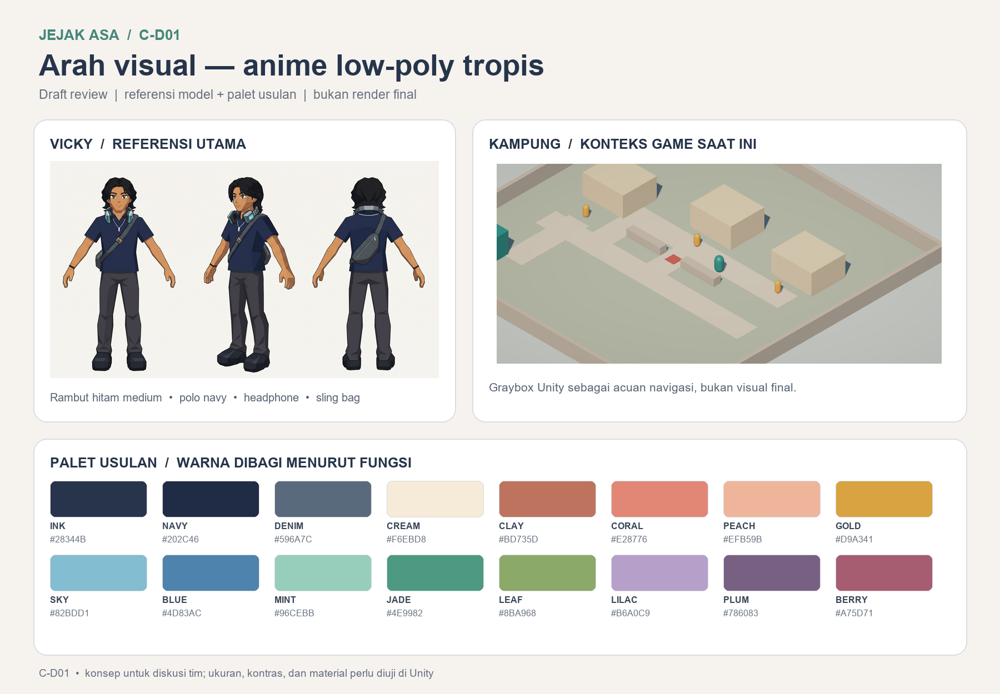
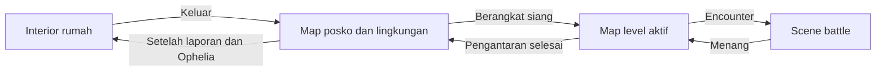

# C-D01 — Arah Visual dan Layout Jejak Asa

**Versi:** draft v3. **Status:** arah visual disetujui pengguna; pengujian rute revisi dan beberapa keputusan produksi masih terbuka. Dokumen ini mendampingi [daftar aset Role C](daftar-aset-role-c.md) dan [storyboard](storyboard-dialog-jejak-asa.md); progres pekerjaan inti tetap berada di [README](../README.md).

## 1. Identitas visual

Jejak Asa menggunakan **3D anime stylized low-poly dengan sentuhan realistis secukupnya**: bentuk wajah dan rambut terbaca, pakaian terasa memiliki lapisan, dan kehidupan sehari-hari kampung terlihat hangat. Geometri boleh hemat, tetapi karakter tidak dibuat sekadar kubus/kapsul dengan warna datar. Siluet, ekspresi, warna kulit beragam, lipatan pakaian terpilih, serta benda keseharian memberi karakter tanpa mengejar fotorealisme.

Lingkungan adalah kampung **fiktif** di Jakarta Utara. Gunakan petunjuk lokal yang wajar—teras, pot tanaman, warung, pagar, gang dan papan pengumuman—tanpa mengubah kesulitan ekonomi menjadi tontonan atau menganggap seluruh wilayah Jakarta Utara sama. Cahaya dan warna dapat hidup; tidak perlu seluruh lingkungan abu-abu atau cokelat.

[Papan PNG resolusi penuh](visual/cd01/01-arah-visual-palet.png). Referensi kiri adalah gambar Vicky yang sudah ada; gambar kanan adalah **graybox lama di Unity**, bukan usulan tampilan final. Papan tersebut bukan concept render 3D baru.

### Aturan visual awal

- **Karakter:** proporsi manusia yang distilisasi, wajah anime yang ekspresif, rambut dalam beberapa bidang besar dengan helai/aksen terpilih, bukan kumpulan kubus atau detail fotorealistis yang sulit diproduksi.
- **Permukaan:** tekstur atau warna painted untuk menyiratkan kain, dinding dan material; jaga bentuk tetap mudah dibaca di kamera isometrik. Pencahayaan lembut dan bayangan yang memisahkan karakter dari lantai.
- **Kamera:** lingkungan harus dibaca dari kamera eksplorasi yang mengikuti pemain dengan orientasi tetap. Pintu, penanda, dan jalur tidak boleh tersamarkan oleh atap atau dekorasi.
- **Lokasi:** posko hangat dan aktif; rumah personal dan tenang; gang lebih padat tetapi tetap terbaca; arena battle bersih agar karakter/telegraph menjadi fokus. Kondisi bahaya diberi aksen, bukan membuat keseluruhan kampung tampak menyeramkan.
- **UI:** panel dan teks berkontras tinggi; warna tidak menjadi satu-satunya pembeda state—sertakan label, bentuk, atau ikon. Tata letak final akan dikerjakan di C-D05.

### Palet usulan

Nilai ini adalah titik awal, **bukan pembatas seluruh warna**. Gunakan variasi terang/gelap per material dan karakter; jangan mewarnai semua bangunan sama.

| Kelompok | Warna awal | Penggunaan usulan |
| --- | --- | --- |
| Ink `#28344B`, navy `#202C46`, denim `#596A7C` | Biru/abu gelap | Teks, pakaian Vicky, detail struktur dan bayangan |
| Cream `#F6EBD8`, clay `#BD735D`, coral `#E28776`, peach `#EFB59B` | Netral dan hangat | Panel, dinding, atap, pakaian, aksen keseharian |
| Gold `#D9A341`, sky `#82BDD1`, blue `#4D83AC` | Kuning/biru | Penanda, langit, ornamen dan objek yang perlu dibedakan |
| Mint `#96CEBB`, jade `#4E9982`, leaf `#8BA968` | Hijau | Tanaman, kain, aksen posko dan variasi material |
| Lilac `#B6A0C9`, plum `#786083`, berry `#A75D71` | Ungu/merah | Variasi pakaian, identitas tokoh, serta aksen peringatan |

Pemeriksaan rasio warna teks (perhitungan warna solid sRGB): `#28344B` pada cream `#F6EBD8` ≈ **10,57:1**; `#28344B` pada gold `#D9A341` ≈ **5,51:1**. Putih pada jade `#4E9982` hanya ≈ **3,39:1**, sehingga jangan dipakai sebagai teks kecil; `#101820` pada jade ≈ **5,29:1**. Ini bukan pengganti uji ukuran teks dan kontras aktual di Unity, terutama pada tekstur/transparansi.

## 2. Karakter: acuan dan batas

**Vicky:** [referensi MC](visual/asset-guides/refs/Vicky.jpg). Pengguna menyetujui memakai model Meshy yang sudah dibuat walaupun bentuknya tidak rapi; jangan regenerasi hanya untuk merapikan bentuk.

**Model yang sudah ada:** [GLB sumber](../ArtSource/Characters/MC_Meshy/JejakAsa_MC_Original.glb) dan [FBX preview](../Unity/JejakAsa/Assets/_Project/Art/Characters/MC/JejakAsa_MC_Unity_Test.fbx) berasal dari percobaan Meshy sebelumnya. Preview dilaporkan sekitar 1,70 m dan 32.687 triangle; belum ber-rig/animasi final dan belum dinyatakan siap produksi. Pemeriksaan dan integrasinya termasuk C-D02.

**Tokoh lain:** gambar yang diberikan pengguna menjadi acuan visual utama: [Jonathan](visual/asset-guides/refs/Jonathan.jpg), [Ophelia](visual/asset-guides/refs/Ophelia.jpg), [preman](visual/asset-guides/refs/Preman.jpg), [Mr. Deddy](visual/asset-guides/refs/Mr.Deddy.jpg), [Mr. Gas Oke](<visual/asset-guides/refs/Mr. Gas Oke.jpg>), [Ibu](visual/asset-guides/refs/Ibu.jpg), [Ayah](visual/asset-guides/refs/Ayah.jpg), [warga perempuan](visual/asset-guides/refs/Warga-Female.jpg), dan [warga laki-laki](visual/asset-guides/refs/Warga-Male.jpg). Nama file boss tidak dengan sendirinya mengonfirmasi nama final.

Warga dapat memakai basis dan variasi yang digunakan ulang; 15 nama pada draft cerita tidak mewajibkan 15 mesh unik. Ibu dan Ayah boleh memakai karakter sederhana sebagaimana diminta. Hindari menjadikan bentuk tubuh, warna kulit, atau kondisi rumah sebagai penanda moral tokoh.

### Karakter: kondisi referensi

Gambar Jonathan, Ophelia, preman, Mr. Deddy, Mr. Gas Oke, Ibu dan Ayah telah diberikan pengguna. Gambar-gambar tersebut menampilkan tampak depan, **tiga-perempat**, dan belakang; bukan tampak samping ortografis dan bukan model 3D. Gunakan gambar yang diberikan, bukan usulan pakaian sebelumnya. Apabila pemodelan atau rigging memerlukan tampak samping tepat 90°, sudut itu masih perlu disiapkan atau diputuskan berdasarkan model.

Ophelia pada referensi pengguna memiliki rambut biru dan pakaian hitam; itu adalah acuan yang diberikan, bukan interpretasi lama berambut hitam/overshirt salmon.

## 3. Ukuran graybox yang benar-benar teramati

Diukur dari `Assets/_Project/Scenes/Kampung.unity` melalui Unity Editor 6000.3.27f1 dengan preview scene yang ditutup kembali, tanpa menyimpan perubahan scene. X/Z adalah koordinat horizontal; dimensi dalam satuan Unity, diasumsikan meter. Ini **kondisi graybox lama**, bukan persetujuan layout revisi.

| Elemen | Nilai teramati |
| --- | --- |
| Lantai `Plane` | 40 × 40 m |
| Player | spawn X/Z `(-12, -11)`; `CharacterController` radius **0,5 m**, tinggi **2 m**, skala `(1,1,1)` |
| Interaksi warga | jarak horizontal `1,8 m` pada komponen scene |
| PosBantuan lama | pusat X/Z `(-16, -13)`; bounds sekitar **6 × 3 × 3 m** (X × Y × Z); belum merupakan scene posko baru |
| Tiga massa rumah graybox | masing-masing **6 × 3 × 5 m** (X × Y × Z); pusat X/Z `(-12,4)`, `(0,8)`, `(12,8)` |
| Warga graybox | X/Z `(-12,-1)`, `(0,3.5)`, `(12,3.5)` |
| Penghalang utama | lebar X **3 m**, tinggi Y **0,7 m**, tebal Z **0,35 m**, pusat X/Z `(0,0.35)` |
| Kamera eksplorasi | orthographic size `10,5`; rotasi kira-kira `(35,26°, 315°, 0°)` |

### Hasil uji Unity

- **Prefab Vicky:** bounds statis terukur sekitar **1,01 × 1,70 × 0,50 m** (X × Y × Z). Model dipasang sementara sebagai visual pada player saat uji; scene tidak disimpan.
- **Bukaan uji sementara:** controller asli melewati bukaan **1,5 m × 2,2 m** lurus dan diagonal terpusat, serta gang **2 m** dengan gerak diagonal terpusat. Kontrol negatif bukaan **0,8 m** menahan controller. Ini uji collider sederhana, bukan jaminan semua arah atau animasi visual bebas clipping.
- **Rute graybox lama:** `U02KampungRouteTests` dan `U02MovementTests` lulus **5/5** di Play Mode; pengujian meliputi waypoint rute utama/memutar, gerak, tanah dan collision rumah. Rute utama diuji setelah penghalang diselesaikan.
- **Belum diuji:** dimensi paket, animasi/rig Vicky, atau jalur posko, rumah dan lima map revisi, karena scene-nya belum tersedia. Uji sementara sudah dihapus; tidak ada perubahan scene tersimpan. Ulangi pengujian setelah layout/props revisi dibangun.

### Ukuran usulan untuk perancangan

- **Karakter:** tinggi visual Vicky dapat mulai sekitar 1,7 m, tetapi visual harus diposisikan terhadap controller 2 m dan titik kaki; jangan mengubah collider agar cocok dengan model tanpa pengujian A/B.
- **Pintu yang dilewati:** bukaan bersih **1,5 m lebar × 2,2 m tinggi** dan gang **2 m** telah lolos uji collider sederhana di atas. Angka tersebut bukan jaminan untuk setiap sudut, animasi, atau scene baru.
- **Paket:** mulai dengan kardus sekitar **0,45 × 0,35 × 0,35 m**; sesuaikan dengan tangan, siluet dan kebutuhan animasi. Belum diukur pada objek game final.
- **Pintu yang hanya menjadi titik transisi**, bukan dilewati secara fisik, boleh memakai ukuran artistik setelah cara transisi diputuskan.
- Uji ulang bukaan, akses semua tujuan, rotasi karakter, interaksi pada radius 1,8 m dan visibilitas kamera pada setiap scene revisi. Atap dan prop visual tidak boleh menutup jalur atau menggeser target ke area yang tak bisa dijangkau.

## 4. Prinsip layout revisi

Denah C-D01 adalah **rancangan konseptual, bukan map yang sudah dibangun atau diuji**. Posko adalah satu map mandiri dengan lingkungan di sekelilingnya; rumah adalah map terpisah yang langsung menampilkan interior, tanpa map luar rumah; masing-masing dari lima level merupakan map tersendiri. Map-map tersebut tidak tersambung secara fisik.

Posko memiliki **satu gerbang masuk/keluar**. Saat pemain mendekatinya untuk pergi, muncul pilihan **Pulang ke Rumah**, **Berangkat ke Level**, atau **Batal**; ketersediaan tujuan mengikuti progres game. Pemain yang tiba dari rumah atau level masuk melalui gerbang yang sama. Setelah kembali dari level, Vicky melapor dan berbicara dengan Ophelia sebelum pulang; setelah istirahat di rumah, ia kembali ke posko keesokan hari. Penanganan kekalahan dan posisi kembali dari battle tetap mengikuti kontrak A/B.

### Lembar denah

- [Map posko dan lingkungan sekitarnya](visual/cd01/layout-kampung-draft.png).
- [Interior rumah Vicky dan arena battle terpisah](visual/cd01/layout-interior-arena-draft.png).
- [Lima map level tersendiri](visual/cd01/layout-variasi-level-draft.png).

Ketiga gambar adalah diagram tidak berskala, bukan tampilan final atau bukti rute telah diuji. Level 1 tidak mewajibkan encounter. Tiga penerima per level dan titik intimidasi/boss masih usulan; urutan kunjungan bebas. Kamera belum diberi posisi/arah dan harus ditentukan bersama A/B.

- **Posko:** satu map yang mencakup bangunan dan lingkungan di sekelilingnya, area Jonathan/Ophelia, serta **satu gerbang bersama** untuk kedatangan dan keberangkatan. Gerbang membuka pilihan rumah atau level; papan jadwal boleh menjadi dekorasi/informasi, bukan pintu level kedua.
- **Rumah:** satu map interior saja, berisi spawn, Ibu dan Ayah, area makan, dan tempat tidur/titik save. Keluar rumah membawa pemain ke posko, bukan ke map luar rumah atau langsung ke level.
- **Map level 1–5:** setiap level memiliki map dan susunan jalannya sendiri, terpisah dari posko dan rumah. Aset modular boleh digunakan ulang antar-map, tetapi layout, lingkungan dan penempatan bukan sekadar satu map yang sama diganti nama.
- **Battle:** area/scene battle terpisah yang diakses dari map level; sediakan ruang animasi dan UI, serta cegah kamera/listener ganda. Setelah menang, kembali ke level terkait sesuai sistem yang akan disepakati.
- **Urutan tujuan:** level 1 memperkenalkan pengantaran; level 2 menambah intimidasi; level 3 menghadirkan Deddy; level 4 memperkuat tekanan; level 5 menghadirkan boss terakhir. Penempatan detail dan jumlah penerima masih usulan.

## 5. Keputusan dan review

| Keputusan | Status | Catatan |
| --- | --- | --- |
| 3D anime stylized low-poly dengan sedikit realisme | Disetujui pengguna | Penerapan material dan pencahayaan tetap perlu diuji di Unity |
| Model Meshy Vicky yang sudah dibuat | Disetujui pengguna untuk dipakai | Tidak wajib merapikan bentuk; skala, rig/animasi dan integrasi gameplay tetap perlu diperiksa |
| Palet dan arah visual | Disetujui pengguna | Uji kontras dan suasana pada aset Unity nyata |
| Struktur map | Arahan pengguna | Posko dengan lingkungan, rumah langsung interior, dan lima map level terpisah; penempatan detail perlu disepakati |
| Model reuse warga dan modul bangunan | Usulan efisiensi | Cukup variasi agar tokoh dan rumah tetap terbaca berbeda |
| Nama boss terakhir | Belum diputuskan | Mr. Gas Oke atau Mr. Oke Gas |
| Ukuran pintu, gang, dan paket | Sebagian diuji | Pintu dan gang lulus uji collider sederhana; paket dan layout revisi belum diuji |
| Persetujuan visual | Pengguna menyetujui arah visual | Denah revisi, skala jalur baru dan penerimaan bersama A/B masih perlu dibuktikan |

**Langkah berikutnya:** gunakan model Meshy Vicky yang sudah dipilih untuk C-D02; integrasikan rig/animasi, lalu uji ulang pada map revisi setelah A/B membuatnya. Tidak ada job generator baru dalam pekerjaan ini.
