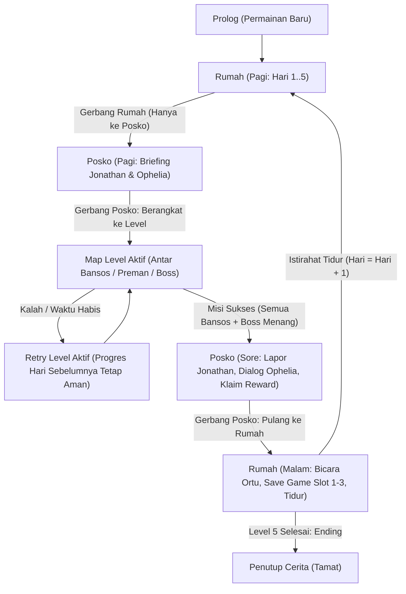

# R01 — Kontrak Alur dan Arsitektur Siklus Harian (AB-D01)

**Status:** Kesepakatan Kontrak Alur A/B/C  
**Terkait:** [README.md](../README.md#L98) (R01, AB-D01), [storyboard-dialog-jejak-asa.md](storyboard-dialog-jejak-asa.md), [cd01-arah-visual.md](cd01-arah-visual.md)

---

## 1. Ringkasan Siklus Harian (Daily Loop)

Game Jejak Asa beralih dari sekadar graybox terisolasi menjadi **siklus hidup pemukiman yang kohesif ala Citampi Stories**:
1. **Interior Rumah** (`Rumah.unity`): Tempat bangun tidur, save game, interaksi orang tua, dan istirahat malam.
2. **Posko lapangan** (`Posko.unity`): Pemain tiba dari rumah melalui gerbang bersama, mengikuti briefing Pak Jonathan dan mengambil paket bantuan sebelum berangkat.
3. **Map Penyaluran / Misi Level** (`Kampung.unity`, `Kampung_L2.unity`–`Kampung_L5.unity`): Lima layout graybox untuk pengantaran bantuan dan encounter; level 3 dan 5 memiliki boss.
4. **Kembali ke Posko dan Rumah**: Setelah penyaluran berhasil, pemain kembali ke posko untuk laporan Jonathan dan dialog Ophelia, lalu menggunakan gerbang yang sama untuk pulang ke interior rumah.

---

## 2. Definisi State Siklus Harian (`DayPhase`)

| State (`DayPhase`) | Lokasi Scene | Aksi Wajib Pemain | Akses Gerbang Keluar |
|---|---|---|---|
| `Prolog` | `Rumah` / Cutscene | Pengenalan Vicky, Ibu, dan ide posko | Hanya menuju Posko |
| `RumahPagi` | `Rumah.unity` | Bangun tidur, bicara orang tua (opsional) | Hanya menuju Posko (`Pulang` tidak relevan) |
| `PoskoBriefing` | `Posko.unity` | Bicara dengan Pak Jonathan dan ambil paket bantuan | Gerbang Level **terkunci** sampai briefing dan pengambilan paket selesai. Gerbang Rumah terkunci. |
| `DiLevel` | Lima scene level | Selesaikan 3 pengantaran bansos; kalahkan boss pada L3/L5 | Setelah hasil sukses dikonfirmasi, kembali ke Posko |
| `PoskoLaporan` | `Posko.unity` | Lapor hasil ke Jonathan, dialog Ophelia, klaim reward | Gerbang Rumah terbuka setelah lapor & dialog Ophelia selesai |
| `RumahMalam` | `Rumah.unity` | Simpan progres (Save Slot 1–3), istirahat/tidur | Pilihan tidur memajukan hari (`Hari++`) |
| `Tamat` | `Rumah.unity` | Penutup cerita dan kembali ke Menu Utama | Selesai |

---

## 3. Kontrak Data Persisten (`GameProgressData`)

Data yang dipersistensikan dan tidak boleh hilang saat transisi antar scene:
- **`currentDay`** (int 1..5): Hari aktif.
- **`currentLevel`** (int 1..5): Level aktif yang sedang dijalankan.
- **`currentPhase`** (`DayPhase`): Tahap alur harian aktif.
- **`isBriefingDone`** (bool): Menandai pemain sudah briefing dengan Jonathan di hari tersebut.
- **`isLevelCompleted`** (bool): Menandai misi level hari itu telah berhasil diselesaikan.
- **`isReportDone`** (bool): Menandai laporan misi ke Jonathan telah selesai.
- **`isOpheliaTalkDone`** (bool): Menandai dialog lanjutan dengan Ophelia telah selesai.
- **`hasClaimedReward`** (bool): Menandai reward harian sudah diterima (tepat 1x per level).
- **`inventory`** (`List<string>`): Item dan senjata yang dimiliki pemain.
- **`completedLevels`** (`List<int>`): Riwayat level yang telah diselesaikan.

---

## 4. Keputusan Terbuka yang Disepakati (AB-D01)

1. **Sistem Simpan / Muat (Save/Load):**
   - Disediakan **3 slot simpanan**.
   - Simpanan dilakukan di **Rumah** saat malam hari (sebelum tidur) atau melalui menu jeda saat berada di Rumah.
   - **Tidak ada autosave di tengah map level** agar alur retry dan evaluasi kegagalan tetap bersih, deterministik, dan bebas exploit.
2. **Aturan Kegagalan & Retry per Level:**
   - Jika pemain kalah dalam battle atau waktu misi habis, pemain dapat memilih **Ulang Misi (Retry)**.
   - Retry me-reset data level aktif (bansos, posisi preman, timer), tetapi **TIDAK MENGHAPUS** progres hari-hari sebelumnya.
3. **Mekanik Menghindar 50/50:**
   - Saat encounter preman, memilih `Menghindar` memiliki peluang 50% berhasil mundur ke safe waypoint dan 50% gagal langsung masuk battle.
   - Timer misi membeku selama panel dialog/pilihan encounter dan battle berlangsung; timer berlanjut kembali saat pemain berada dalam eksplorasi aktif.
4. **Bantuan Warga:**
   - Membutuhkan minimal 1 pengantaran sukses (`Trust >= 1`) pada level aktif. Jika trust belum cukup, tombol terkunci dengan alasan yang jelas.
5. **Reward Level:**
   - Diberikan tepat 1 kali per level di Posko setelah melapor ke Jonathan dan berbincang dengan Ophelia.
6. **Core item sementara:** reward level 2 memberikan `basic_weapon` (+5 serangan); reward level lainnya memberikan `healing_item` (pulih hingga 12 HP, habis satu dan satu giliran). Nama serta angka ini perlu disepakati sebagai desain final.

---

## 5. Pembagian Tanggung Jawab Role

- **Role A (Gameplay & Integrasi):**
  - Mengimplementasikan `GameFlowManager` (state machine alur harian & transisi scene).
  - Membuat scene graybox `Posko.unity` dan `Rumah.unity` dengan titik interaksi Jonathan, Ophelia, Ibu/Ayah, tempat tidur, dan gerbang bersama (AB-D02).
  - Mengatur transisi spawn dan persistensi data antar scene.
- **Role B (Battle & Verifikasi):**
  - Menguji kontrak transisi dan state machine lewat automated PlayMode tests.
  - Memastikan integrasi battle boss (Mr. Deddy L3, Mr. Gas Oke L5) mengembalikan hasil secara benar ke flow level.
  - Memverifikasi loop 3× retry, save/load slot, dan isolasi reset level aktif.
- **Role C (Visual, Level, UI):**
  - Menyediakan aset interior Rumah, lapangan Posko, dan 5 variasi layout level bertahap sesuai [C-D01](cd01-arah-visual.md).
  - Menyiapkan prefab UI dialog, menu gerbang posko, dan save/load menu (C-D05).

